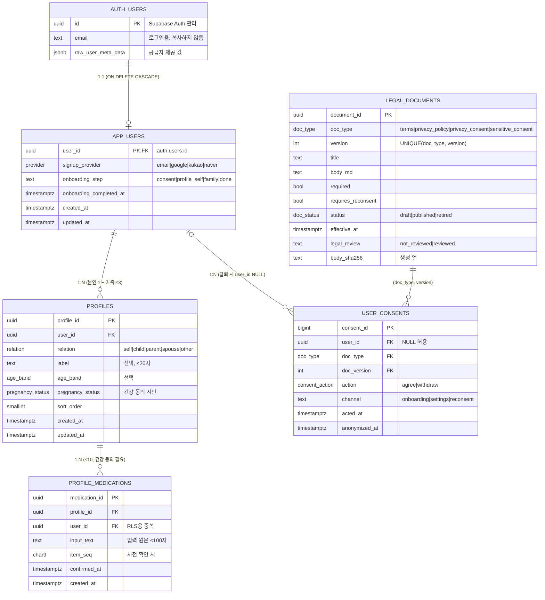

# PJ2-계정-프로필-데이터 · Can I PPiyak (코드명 MediAgent)

**DATA DESIGN: 계정·프로필·약관·동의 데이터 설계**

> 작성 2026-11-18 밤(사용자 요청: "수퍼베이스의 RDB를 활용하여 user 테이블에 대한 관리", "프로필 설정에 자녀와 부모를 추가", "이용약관, 개인정보, 민감정보 들에 대해서도 RDB에서 관리 … 추후 수정시 DB만 손보면 되기에", "온보딩에서 수집한 정보들에 대해서 처리할 ERD 설계와 DB 적재"). 티켓: [BE-11](../tickets/backend/BE-11.md)·[FE-04](../tickets/frontend/FE-04.md). 상태: **설계 초안, 코드·마이그레이션 없음, 원격 적용 0.** SQL과 시드는 이 문서 부록(A·B)의 초안이며, 파일로 옮기고 원격에 적용하는 일은 결정(14장)과 승인 flag 뒤다(12장).
> 근거로 삼은 결정: PRD-01-05 B(계정 서버 저장), PRD-01-09 A′(소셜 로그인. 요구서 표기는 "PRD-01-06 A′", 14.1절), AG-10-06 A(프로필·온보딩을 축소 순서에서 뺌, W2~W3), RFP-30-08 A(2일 스프린트 S1~S3), BE-11-01 B·BE-11-02~05 A(2026-11-18). 법률 검토는 거치지 않았다(PJ2-RFP.md 12장 위험 표 ①②). 이 문서의 약관·동의 문서 본문 시드는 모두 "초안·법률 검토 전"이다.

## Index
- [1. 목적과 범위](#1-목적과-범위)
  - [1.1 목적](#11-목적)
  - [1.2 스프린트 범위(S1~S3)](#12-스프린트-범위s1s3)
  - [1.3 근거 결정](#13-근거-결정)
  - [1.4 범위 밖](#14-범위-밖)
- [2. 데이터 원칙](#2-데이터-원칙)
  - [2.1 저장하는 것](#21-저장하는-것)
  - [2.2 저장하지 않는 것](#22-저장하지-않는-것)
  - [2.3 접근 통제의 두 겹](#23-접근-통제의-두-겹)
- [3. ERD](#3-erd)
- [4. 테이블 정의](#4-테이블-정의)
  - [4.1 enum](#41-enum)
  - [4.2 app_users(계정·온보딩 상태)](#42-app_users계정온보딩-상태)
  - [4.3 profiles(본인·가족 프로필)](#43-profiles본인가족-프로필)
  - [4.4 profile_medications(복용 중인 약)](#44-profile_medications복용-중인-약)
  - [4.5 legal_documents(약관·동의 문서)](#45-legal_documents약관동의-문서)
  - [4.6 user_consents(동의·철회 기록)](#46-user_consents동의철회-기록)
  - [4.7 auth.users(Supabase Auth, 우리가 만들지 않음)](#47-authuserssupabase-auth-우리가-만들지-않음)
  - [4.8 age_band ↔ 나이 구간 대응](#48-age_band--나이-구간-대응)
- [5. RLS 정책](#5-rls-정책)
  - [5.1 정책 표](#51-정책-표)
  - [5.2 백엔드가 RLS 아래에서 도는 방식](#52-백엔드가-rls-아래에서-도는-방식)
- [6. 동의 흐름](#6-동의-흐름)
  - [6.1 필수·선택 동의](#61-필수선택-동의)
  - [6.2 건강 정보 별도 동의(BE-11-03 A)](#62-건강-정보-별도-동의be-11-03-a)
  - [6.3 철회 시 삭제 트리거](#63-철회-시-삭제-트리거)
- [7. 탈퇴·보관](#7-탈퇴보관)
  - [7.1 탈퇴 순서](#71-탈퇴-순서)
  - [7.2 동의 기록 보관 선택지](#72-동의-기록-보관-선택지)
  - [7.3 조사 결과 반영 자리](#73-조사-결과-반영-자리)
- [8. 약관 문서 버전 관리](#8-약관-문서-버전-관리)
- [9. API 계약](#9-api-계약)
  - [9.1 공통(인증 헤더·게스트·오류)](#91-공통인증-헤더게스트오류)
  - [9.2 엔드포인트 표](#92-엔드포인트-표)
  - [9.3 응답 스키마](#93-응답-스키마)
- [10. 온보딩 화면 흐름 ↔ 테이블](#10-온보딩-화면-흐름--테이블)
- [11. chat 연동](#11-chat-연동)
- [12. 마이그레이션·시드 적재 절차](#12-마이그레이션시드-적재-절차)
- [13. 시험 계획](#13-시험-계획)
- [14. 결정 후보](#14-결정-후보)
  - [14.1 확인된 문서 충돌](#141-확인된-문서-충돌)
  - [14.2 결정 후보 표](#142-결정-후보-표)
- [15. 코드 대조·출처](#15-코드-대조출처)
- [부록 A. 마이그레이션 SQL 초안](#부록-a-마이그레이션-sql-초안)
- [부록 B. 약관·동의 문서 시드 초안](#부록-b-약관동의-문서-시드-초안)

## 1. 목적과 범위

### 1.1 목적
로그인한 사용자의 **계정·프로필(본인 + 가족 최대 3명)·복용 중인 약·약관/동의 문서·동의 기록**을 Supabase Postgres에 두는 데이터 구조와, 그것을 다루는 FastAPI 계약을 정한다. 약관·개인정보·민감정보 문서는 DB에 버전으로 두고 프런트는 API로 받아 그리므로, 문구를 고칠 때 **새 버전 행만 넣으면 된다**(BE-11-02 A, 사용자 "추후 수정시 DB만 손보면 되기에").

이 확장은 Agent-RAG 핵심(Router·도구 선택·근거 고정·Validator·평가)을 바꾸지 않는다. 프로필은 `/chat` 요청의 `context`를 채우는 **입력 출처 하나**가 늘어나는 것뿐이다(11장).

### 1.2 스프린트 범위(S1~S3)
RFP-30-08 A의 2일 스프린트에 맞춘 데이터·API 범위다.

| 스프린트 | 화면·인증 | 이 문서의 데이터·API 범위 |
|---|---|---|
| S1 인증 | 이메일·Google·Kakao 로그인, 게스트 유지 | `app_users`, `legal_documents`(시드), `user_consents`, `GET /legal/*`, `GET /me`, `POST /consents`, `DELETE /me`, 백엔드 JWT 검증 |
| S2 프로필·온보딩 + Naver | 온보딩 단계, 프로필 CRUD, Naver 연동(방식 확인 뒤) | `profiles`, `profile_medications`, 프로필 CRUD API, 건강 정보 동의·철회 트리거, `provider='naver'` |
| S3 chat 연동 | "누가 먹나요" 대상 선택 | 프로필 → `context` 변환(프런트), `/chat` 무변경 확인 |

### 1.3 근거 결정
| 번호 | 내용 | 이 문서의 반영 |
|---|---|---|
| PRD-01-05 B | 계정(Supabase Auth)으로 서버 저장 | 4장 전체 |
| PRD-01-09 A′(2026-11-18, 요구서 표기 "PRD-01-06 A′") | 소셜 로그인 Google·Kakao S1, Naver S2, Apple 제외, 이메일 포함 | 4.1절 `provider` enum |
| AG-10-06 A | 프로필·온보딩을 축소 순서에서 빼고 W2~W3 | 1.2절 |
| BE-11-01 B | 본인 + 가족 최대 3명, 관계 칸 | 4.3절 행 수 제한·`relation` |
| BE-11-02 A | `legal_documents` + `user_consents`, 프런트는 API로 받아 표시 | 4.5·4.6·8·9장 |
| BE-11-03 A | 건강 정보(임신 여부·복용 약)는 별도 선택 동의, 미동의면 그 칸 저장 안 함 | 6.2절, 부록 A 트리거 |
| BE-11-04 A | 탈퇴 시 프로필·약 즉시 삭제, 동의 기록은 식별자를 지운 채 보관(기간은 조사 뒤) | 7장 |
| BE-11-05 A | 복용 약은 입력 원문 + 사전 확인 시 `item_seq` | 4.4절 |
| PRD-07-01 A | 서버는 대화 상태를 저장·로그하지 않고 요청의 `context`만 쓴다 | 11장 |
| FE-07-18 A | 프로필 나이로 연령금기 판정, 특정할 수 없으면 나이별 원문 값 | 4.8·11장 |

### 1.4 범위 밖
질문·대화 이력 저장(PRD-07-01 A, 3주 범위 밖), Apple 로그인, 알레르기(PRD-01-03 A에서 제외), 임신 주차(FE-07-12 B는 "추후 확장", 14.2절 BE-11-09 후보), 마케팅 수신 동의, 관리자 화면(약관 수정은 SQL로 새 버전 행 삽입).

## 2. 데이터 원칙

### 2.1 저장하는 것
- **로그인 최소 정보**: Supabase Auth가 `auth.users`에 두는 값(이메일, 공급자 식별자). 우리 테이블에는 **이메일을 복사하지 않는다**(이메일은 로그인에만, PJ2-RFP.md 7장 개인정보 `:331`).
- **일반 프로필(필수 동의 `privacy_consent`)**: 관계(`relation`), 화면 표시용 짧은 이름(`label`, 선택, 실명 대신 "아이"·"엄마" 권장), 연령대(`age_band`).
- **건강 정보(선택 동의 `sensitive_consent`)**: 임신 여부(`pregnancy_status`), 복용 중인 약(`profile_medications`).
- **동의 기록**: 어떤 문서의 몇 번째 버전에 언제 동의·철회했는지.

### 2.2 저장하지 않는 것
- 질문·대화 내용, `/chat` 요청 본문, 모델 출력(NFR-04, PRD-07-01 A). 계정 테이블과 `/chat` 경로는 서로 쓰지 않는다(11장).
- 게스트 사용자의 어떤 값도(게스트는 토큰이 없으므로 계정 API를 부를 수 없다).
- 사진·음성(FR-11, PRD-08-04).
- 프로필 값의 로그: API 접근 로그는 BE-15 비밀값 가드·RFP-34 집계 규칙대로 경로·상태 코드·지연만 남기고 본문은 남기지 않는다.

### 2.3 접근 통제의 두 겹
1. **RLS**: 모든 계정 테이블에 RLS를 켜고 `auth.uid()` 기준으로 본인 행만 허용한다(5장).
2. **노출하지 않는 스키마**: 계정 테이블은 `public`이 아니라 새 스키마 `account`에 둔다. Supabase Data API(PostgREST)는 설정한 스키마만 노출하므로(기본 `public`) 브라우저가 계정 테이블을 직접 부르지 못하고 FastAPI만 거친다. `public`에 둔 사전 테이블을 RLS + REVOKE로 막은 BE-06-32 A(`backend/app/db/schema_dict_pg.sql:3-6`)와 같은 목적이다. 노출 스키마 설정은 확인 필요(14.2절 BE-11-06 후보).

백엔드가 테이블 소유 역할(`SUPABASE_DB_URL`의 postgres 계열)로 접속하면 RLS를 **우회한다**(`schema_dict_pg.sql:5-6`의 가정과 같다). 그래서 계정 API는 요청마다 `authenticated` 역할로 내려가 RLS 아래에서 돈다(5.2절). 이렇게 해야 RLS가 장식이 아니라 실제 방어선이 되고, 다른 계정 시험(13장)이 의미를 갖는다.

## 3. ERD



`onboarding_state`는 별도 테이블로 두지 않고 `app_users`의 두 열(`onboarding_step`·`onboarding_completed_at`)로 접었다. 계정마다 한 행이고 이력이 필요 없어 1:1 테이블을 하나 더 두면 조인과 RLS 정책만 늘기 때문이다.

## 4. 테이블 정의
모든 테이블은 스키마 `account`에 둔다. 시각은 `timestamptz`(UTC 저장, 화면은 Asia/Seoul). 전체 DDL은 부록 A.

### 4.1 enum
| enum | 값 | 근거·메모 |
|---|---|---|
| `provider` | `email`, `google`, `kakao`, `naver` | 이메일 포함, Apple 제외(PRD-01-09 A′). 값은 가입 경로 기록용이며 공급자 연결 목록의 원본은 `auth.identities`다 |
| `relation` | `self`, `child`, `parent`, `spouse`, `other` | BE-11-01 B "관계 칸: 자녀·부모 등". `spouse`·`other`는 "등"에 대한 가정(14.2절 BE-11-08 후보) |
| `pregnancy_status` | `pregnant`, `not_pregnant`, `unknown` | NULL = 입력 안 함 또는 건강 동의 없음. `unknown`은 사용자가 "모름"을 고른 것(판정 입력은 `pregnant=None`과 같다, 11장) |
| `age_band` | 4.8절 표의 11개 | 연령대(PRD-01-03 A). 경계는 연령금기 기준값에 맞춘 가정(14.2절 BE-11-07 후보) |
| `doc_type` | `terms`, `privacy_policy`, `privacy_consent`, `sensitive_consent` | 사용자 "이용약관, 개인정보, 민감정보". 처리방침(`privacy_policy`)은 공개 고지이고 동의 대상이 아니다. 수집·이용 동의(`privacy_consent`)와 민감정보 동의(`sensitive_consent`)는 따로 둔다 |
| `doc_status` | `draft`, `published`, `retired` | 8장 |
| `consent_action` | `agree`, `withdraw` | 4.6절 |

외부 AI 전송 고지(`START_EXTERNAL_AI_NOTICE`, PJ2-PRD.md 15.3절 (9))는 **DB 문서가 아니라 코드 상수**로 둔다. 고정 문구는 코드로 강제한다는 원칙(CLAUDE.md 1장 하네스 원칙)과 "고지이며 동의 관문이 아니다"(PJ2-PRD.md:362)를 지키기 위해서다. 처리방침 본문에는 같은 사실을 서술한다(부록 B).

### 4.2 app_users(계정·온보딩 상태)
| 열 | 타입 | 제약 | 설명 |
|---|---|---|---|
| `user_id` | uuid | PK, FK → `auth.users(id)` ON DELETE CASCADE | Supabase Auth 사용자와 1:1 |
| `signup_provider` | `provider` | NOT NULL | 첫 가입 경로. JWT의 `app_metadata.provider`에서 백엔드가 채운다 |
| `onboarding_step` | text | NOT NULL DEFAULT `'consent'`, CHECK ∈ {consent, profile_self, family, done} | 10장 단계 |
| `onboarding_completed_at` | timestamptz | NULL 허용 | `done`이 된 시각 |
| `created_at`·`updated_at` | timestamptz | NOT NULL DEFAULT now() | `updated_at`은 트리거로 갱신 |

행은 **백엔드가 첫 `GET /me`에서 만든다**(INSERT … ON CONFLICT DO NOTHING). `auth.users`에 트리거를 거는 방식(가입과 동시에 행 생성)은 트리거 실패가 가입 자체를 막고 `auth` 스키마를 건드리므로 쓰지 않는다(14.2절 BE-11-10 후보).

### 4.3 profiles(본인·가족 프로필)
| 열 | 타입 | 제약 | 설명 |
|---|---|---|---|
| `profile_id` | uuid | PK DEFAULT gen_random_uuid() | |
| `user_id` | uuid | NOT NULL, FK → `app_users` ON DELETE CASCADE | |
| `relation` | `relation` | NOT NULL | 본인은 `self` |
| `label` | text | NULL 허용, 1~20자 | 화면 표시용. 실명을 권하지 않는다(화면 안내) |
| `age_band` | `age_band` | NULL 허용 | |
| `pregnancy_status` | `pregnancy_status` | NULL 허용, **건강 동의가 있을 때만 NULL이 아닌 값**(트리거) | |
| `sort_order` | smallint | NOT NULL DEFAULT 0, 0~3 | 화면 순서 |
| `created_at`·`updated_at` | timestamptz | | |

- **행 수 제한**: 계정당 4행(본인 1 + 가족 3, BE-11-01 B). 트리거가 `pg_advisory_xact_lock`으로 같은 계정의 동시 삽입을 줄 세운 뒤 센다(부록 A `enforce_profile_limit`). 초과는 `P0001 PROFILE_LIMIT` → API 409.
- **본인 1행**: 부분 유일 색인 `UNIQUE (user_id) WHERE relation = 'self'`.
- 색인: `(user_id)`.

### 4.4 profile_medications(복용 중인 약)
| 열 | 타입 | 제약 | 설명 |
|---|---|---|---|
| `medication_id` | uuid | PK | |
| `profile_id` | uuid | NOT NULL, FK → `profiles` ON DELETE CASCADE | |
| `user_id` | uuid | NOT NULL, FK → `app_users` ON DELETE CASCADE | RLS 정책을 조인 없이 쓰려고 중복 저장. 트리거가 `profiles.user_id`와 같은지 검사 |
| `input_text` | text | NOT NULL, 공백 아님, 1~100자 | 사용자가 입력한 원문(BE-11-05 A). 길이는 `DRUG_NAME_MAX_CHARS`(`backend/app/api/request.py:19`)와 같다 |
| `item_seq` | char(9) | NULL 허용, `^\d{9}$` | 사전(`drug_dict_entry`)에서 확인됐을 때만. 형식은 `ConfirmedDrug.item_seq`(`request.py:49`)와 같다 |
| `confirmed_at` | timestamptz | `item_seq`가 있으면 NOT NULL | 사전 확인 시각 |
| `created_at` | timestamptz | | |

- **건강 동의 필요**: 삽입·수정 때 트리거가 활성 `sensitive_consent`를 확인한다. 없으면 `P0001 CONSENT_REQUIRED` → API 403.
- **개수 상한** 프로필당 10개(`CONFIRMED_DRUGS_MAX`, `request.py:18`과 같게 해 그대로 `context.confirmed_drugs`에 실을 수 있게 한다).
- `item_seq`에 사전 테이블 FK를 걸지 않는다. 사전은 재적재(BE-06-24 B)로 바뀔 수 있고, 사라진 품목도 사용자 입력 원문은 남아야 하기 때문이다.

### 4.5 legal_documents(약관·동의 문서)
| 열 | 타입 | 제약 | 설명 |
|---|---|---|---|
| `document_id` | uuid | PK | |
| `doc_type` | `doc_type` | NOT NULL | |
| `version` | integer | NOT NULL ≥1, `UNIQUE (doc_type, version)` | 1, 2, 3 … |
| `title` | text | NOT NULL | |
| `body_md` | text | NOT NULL | 마크다운 본문. 프런트는 sanitize 후 렌더링(HTML 허용 안 함) |
| `required` | boolean | NOT NULL | 가입·저장에 필수인가(`terms`·`privacy_consent` true, `sensitive_consent` false, `privacy_policy`는 동의 대상이 아니므로 false) |
| `requires_reconsent` | boolean | NOT NULL DEFAULT false | 이 버전이 시행되면 앞 버전 동의자에게 다시 동의를 받는가 |
| `status` | `doc_status` | NOT NULL DEFAULT `draft` | |
| `effective_at` | timestamptz | NOT NULL | 시행 시각 |
| `legal_review` | text | NOT NULL DEFAULT `not_reviewed`, ∈ {not_reviewed, reviewed} | 프런트가 "초안·법률 검토 전" 표지를 그리는 근거 |
| `body_sha256` | text | 생성 열 `sha256(body_md)` | 동의한 본문이 무엇이었는지 사후 대조 |
| `created_at` | timestamptz | | |

- **게시 뒤 본문 불변**: `status <> 'draft'`인 행의 `title`·`body_md`·`version`·`doc_type` 수정을 트리거가 막는다. 고칠 때는 새 버전 행을 넣는다(8장).
- 색인: `(doc_type, status, effective_at DESC)`.

### 4.6 user_consents(동의·철회 기록)
| 열 | 타입 | 제약 | 설명 |
|---|---|---|---|
| `consent_id` | bigint | PK, IDENTITY | |
| `user_id` | uuid | NULL 허용, FK → `app_users` ON DELETE SET NULL | 탈퇴 때 NULL(7장) |
| `doc_type`·`doc_version` | `doc_type`·integer | NOT NULL, FK → `legal_documents(doc_type, version)` | 동의한 바로 그 버전 |
| `action` | `consent_action` | NOT NULL | `agree` 또는 `withdraw` |
| `channel` | text | NOT NULL, ∈ {onboarding, settings, reconsent} | 어디서 했는가 |
| `acted_at` | timestamptz | NOT NULL DEFAULT now() | |
| `anonymized_at` | timestamptz | NULL 허용 | 식별자를 지운 시각(7장) |

- **추가만 한다**(append-only). `authenticated` 역할에 UPDATE·DELETE 권한과 정책이 없다. 현재 상태는 `(user_id, doc_type)`별 가장 최근 행이다(뷰 `account.user_consent_current`, 부록 A).
- `privacy_policy`에는 동의 행을 만들지 않는다(API가 400). 처리방침은 고지 문서다.
- 색인: `(user_id, doc_type, acted_at DESC)`.

### 4.7 auth.users(Supabase Auth, 우리가 만들지 않음)
Supabase Auth가 관리하며 이메일·공급자 identity·`raw_user_meta_data`를 둔다. **Google·Kakao가 넘기는 이름·사진 URL이 `raw_user_meta_data`에 들어갈 수 있다**(가정, 공급자 scope에 따라 다름). 이는 "로그인 최소 정보"(PJ2-RFP.md:331) 밖이므로 공급자 동의 항목을 최소로 요청하고, 실제로 무엇이 저장되는지 S1에서 확인해 처리방침 본문에 맞춘다(14.2절 BE-11-11 후보, `auth-research` 조사와 연결).

### 4.8 age_band ↔ 나이 구간 대응
`/chat`의 `context.age`는 `AgeInput(lower, upper, unit)`이다(`backend/app/api/request.py:29-42`). 프로필의 `age_band`는 아래 표로 바뀐다(프런트 한 곳, 11장). 경계는 연령금기 기준(`age_contra.age_value`·`age_unit`·`age_cond`, `backend/app/db/schema.sql:44-46`)에서 흔히 쓰일 값으로 **가정**했고 원격 판정 테이블의 실제 분포는 아직 세지 않았다(14.2절 BE-11-07 후보).

| `age_band` | 화면 표시 | `lower` | `upper` | `unit` |
|---|---|---|---|---|
| `m0_2` | 생후 3개월 미만 | 0 | 2 | 개월 |
| `m3_5` | 생후 3~5개월 | 3 | 5 | 개월 |
| `m6_11` | 생후 6~11개월 | 6 | 11 | 개월 |
| `y1` | 만 1세 | 1 | 1 | 세 |
| `y2` | 만 2세 | 2 | 2 | 세 |
| `y3_5` | 만 3~5세 | 3 | 5 | 세 |
| `y6_11` | 만 6~11세 | 6 | 11 | 세 |
| `y12_14` | 만 12~14세 | 12 | 14 | 세 |
| `y15_18` | 만 15~18세 | 15 | 18 | 세 |
| `y19_64` | 만 19~64세 | 19 | 64 | 세 |
| `y65_plus` | 만 65세 이상 | 65 | 150 | 세 |

- `upper`는 **만 나이 정수의 포함 상한**으로 쓴다(예: `y3_5`는 만 5세 11개월까지). 그래프가 구간을 이렇게 읽는지(특히 "6세 미만" 기준과 `upper=5`)는 AG 몫이며 확인 필요다. 구간이 기준 나이에 걸리면 판정 대신 나이별 원문 값을 보인다(FE-07-18 A).
- 출생 연월을 받으면 정밀해지지만 수집 항목이 늘어 PRD-01-03 A("연령대")와 어긋난다. 받지 않는다.

## 5. RLS 정책

### 5.1 정책 표
`(select auth.uid())`로 감싸 행마다 함수를 다시 부르지 않게 한다.

| 테이블 | anon | authenticated SELECT | INSERT | UPDATE | DELETE |
|---|---|---|---|---|---|
| `legal_documents` | `status='published'`만 SELECT | `status='published'`만 | 없음 | 없음 | 없음 |
| `app_users` | 없음 | `user_id = auth.uid()` | `user_id = auth.uid()` | 본인 행(열 권한은 `onboarding_*`만) | 없음(탈퇴는 7장 경로) |
| `profiles` | 없음 | 본인 | 본인 | 본인 | 본인 |
| `profile_medications` | 없음 | 본인 | 본인 | 본인 | 본인 |
| `user_consents` | 없음 | 본인 | 본인(`user_id = auth.uid()`) | **없음** | **없음** |

시드·약관 새 버전 넣기·탈퇴 익명화는 소유 역할(마이그레이션 스크립트, 서버)만 한다. SQL은 부록 A 5절.

### 5.2 백엔드가 RLS 아래에서 도는 방식
계정 API는 요청마다 한 트랜잭션 안에서 아래를 실행한다.

```sql
BEGIN;
SET LOCAL ROLE authenticated;
SELECT set_config('request.jwt.claims', :claims_json, true);  -- 검증을 통과한 JWT의 claims(sub·role·aud)
-- 이후 account.* 질의는 RLS를 받는다. auth.uid()는 claims의 sub다.
COMMIT;
```

- claims는 **백엔드가 JWKS로 서명을 검증한 뒤의 값만** 넣는다(9.1절). 검증하지 않은 값을 넣으면 RLS가 무의미해진다.
- 확인 필요(읽기 전용 점검): 소유 역할이 `authenticated`로 `SET ROLE`할 수 있는지(`pg_has_role(current_user, 'authenticated', 'MEMBER')`), `auth.uid()`가 `request.jwt.claims`의 `sub`를 읽는지. 둘 중 하나라도 안 되면 대안은 질의마다 `WHERE user_id = :sub`를 코드로 강제하고 RLS는 Data API 방어로만 두는 것이다(14.2절 BE-11-06 후보).
- 연결은 기존 `SUPABASE_DB_URL`(Session pooler)을 쓴다. `SET LOCAL`은 트랜잭션이 끝나면 풀리므로 풀 연결에 역할이 남지 않는다.

## 6. 동의 흐름

### 6.1 필수·선택 동의
| 문서 | 필수 여부 | 받는 때 | 없을 때 |
|---|---|---|---|
| `terms` 이용약관 | 계정 필수 | 온보딩 1단계 | 계정 API 403 `CONSENT_REQUIRED`(게스트 사용은 그대로) |
| `privacy_consent` 개인정보 수집·이용 | 프로필 저장 필수 | 온보딩 1단계 | 프로필 API 403. 동의 없이 대화 중 입력만(PJ2-PRD.md 15.3절 S10 2단계) |
| `sensitive_consent` 민감정보(건강) 처리 | **선택** | 온보딩 1단계(별도 체크), 설정에서 나중에 | 임신 여부·복용 약 칸을 저장하지 않음(BE-11-03 A) |
| `privacy_policy` 처리방침 | 동의 대상 아님(고지) | 온보딩 1단계에 링크로 표시 | 해당 없음 |

화면은 체크박스를 문서마다 따로 두고 "전체 동의" 하나로 선택 동의까지 묶지 않는다(선택 동의를 필수처럼 보이게 하지 않기 위해서다. 법률 검토 전의 보수적 기본값).

### 6.2 건강 정보 별도 동의(BE-11-03 A)
- DB 트리거 두 개가 강제한다(부록 A `enforce_health_consent_*`): `profiles.pregnancy_status`를 NULL이 아닌 값으로 쓰거나 `profile_medications`에 행을 넣을 때, 그 계정의 최신 `sensitive_consent` 기록이 `agree`가 아니면 거부한다.
- API도 같은 검사를 먼저 해서 403 `CONSENT_REQUIRED`(`doc_type: sensitive_consent`)로 답한다. DB 트리거는 API 검사가 빠졌을 때의 두 번째 방어선이다.
- 건강 동의가 없을 때 화면은 임신 여부·복용 약 칸을 **비활성 + 안내**로 두고, 질문할 때는 대화 중 입력으로 같은 값을 쓸 수 있다(저장만 안 할 뿐 기능은 그대로).

### 6.3 철회 시 삭제 트리거
`user_consents`에 `action='withdraw'` 행이 들어오면 AFTER INSERT 트리거(`on_consent_withdraw`)가 같은 트랜잭션에서 지운다.

| 철회 문서 | 즉시 하는 일 |
|---|---|
| `sensitive_consent` | 그 계정의 모든 `profiles.pregnancy_status` → NULL, `profile_medications` 전부 DELETE |
| `privacy_consent` | 그 계정의 `profiles` 전부 DELETE(약은 CASCADE). 계정은 남는다(14.2절 BE-11-12 후보) |
| `terms` | 트리거가 거부(`P0001 USE_ACCOUNT_DELETE`) → API 409. 약관 철회는 탈퇴(`DELETE /me`)로만 |

삭제는 즉시이며 휴지통·지연 삭제가 없다. 지운 뒤 API는 갱신된 `GET /me` 모양을 돌려준다.

## 7. 탈퇴·보관

### 7.1 탈퇴 순서
`DELETE /me`(9장) 처리 순서다.

1. JWT 검증(본인).
2. 한 트랜잭션(소유 역할): `user_consents`의 그 계정 행을 `user_id = NULL, anonymized_at = now()`로 바꾸고(BE-11-04 A "식별자를 지운 채"), `app_users` 행을 DELETE → `profiles`·`profile_medications` CASCADE 삭제. 7.2절이 B로 정해지면 이 단계에서 동의 기록도 DELETE한다.
3. Supabase Admin API로 `auth.users` 사용자 삭제(서버 전용 `SUPABASE_SECRET_KEY`). 공급자 identity도 함께 지워진다(가정, 확인 필요).
4. 3이 실패하면 502 `AUTH_DELETE_FAILED`를 돌려주고 재시도를 안내한다. 이때 앱 데이터는 이미 지워져 있어 다시 로그인하면 빈 계정이며, 재요청하면 1~3을 다시 한다(멱등). 로그에는 오류 유형만 남긴다.

`auth.users`가 다른 경로로 지워져도 `app_users`가 ON DELETE CASCADE라 프로필은 남지 않는다. 다만 이 경로에서는 2단계의 익명화 UPDATE가 돌지 않고 FK의 SET NULL만 적용되어 `anonymized_at`이 비므로, `app_users`에 BEFORE DELETE 트리거로 `anonymized_at`도 채운다(부록 A).

### 7.2 동의 기록 보관 선택지
| 안 | 내용 | 장점 | 단점 |
|---|---|---|---|
| A | 식별자를 지운 동의 기록을 정해진 기간 보관 후 삭제(기간은 7.3절 조사 결과) | 문서 버전별 동의 수·시점 같은 집계를 남긴다. BE-11-04 A 원문 | 식별자가 없으므로 **특정인의 동의를 증명하는 용도로는 쓸 수 없다**. 보관 기간 근거가 필요 |
| B | 탈퇴 즉시 동의 기록도 삭제 | 남기는 개인 관련 정보 0, 보관 기간 근거 불필요 | 탈퇴자 동의 이력 집계가 사라진다 |

- 보관 기간 근거(법령·고시)를 조사로 찾지 못하면 **B**가 최소 수집 원칙(PJ2-RFP.md 7장)에 맞다. 찾으면 A로 그 기간을 쓴다(14.2절 BE-11-04 후속 후보).
- A의 기간 만료 삭제는 서버 정기 작업이 아니라 수동 SQL로 시작한다(3주 범위, 탈퇴자 수가 적다). 자동화는 범위 밖.
- 사용자 식별자의 해시를 남기는 안은 쓰지 않는다. 해시도 가명정보로 볼 수 있어 "식별자를 지운"과 맞지 않는다(법률 검토 전 판단, 추측).

### 7.3 조사 결과 반영 자리
> **부분 반영(2026-11-18)**: 조사 보고 `data/mock/briefs/reports/auth-research.md`(로컬 전용, 같은 날 작성)를 반영했다. 그 조사는 인증 연동이 범위였고 **동의 기록 보관 기간의 법적 근거는 조사하지 않았다.** 그래서 BE-11-04 후속 후보는 잠정 B로 두고, 보관 근거 조사를 따로 맡긴다(14.2절).

| 항목 | 조사 결과 | 출처(조사 보고가 적은 URL, 읽은 날짜 2026-11-18) |
|---|---|---|
| 동의 기록 보관 의무·기간 근거 | **조사 범위 밖, 미확인** | — |
| Admin API 사용자 삭제 | `auth.admin.deleteUser(id)`(기본 `shouldSoftDelete:false`)이면 `auth.users` 행이 지워지고 cascade로 세션·refresh token이 무효가 된다. **이미 발급된 access token은 `exp`까지 유효**하다. service_role 키가 필요하다 | supabase.com/docs/guides/auth/managing-user-data, supabase.com/docs/reference/javascript/auth-admin-deleteuser |
| 탈퇴 뒤 남은 access token | 이 설계에서는 `GET /me`의 `app_users` 생성이 `auth.users` FK에 막혀 실패하므로 401 `AUTH_INVALID`로 답한다(7.1절 보강, 추론). 다른 계정 API는 `app_users`가 없으면 401로 통일 | 위 + 이 문서 4.2절 |
| `auth.users` 트리거 방식의 위험 | 공식 문서가 "If the trigger fails, it could block signups"라고 경고한다(BE-11-10 A의 근거) | supabase.com/docs/guides/auth/managing-user-data |
| 공급자가 넘기는 항목 | Google scope `openid`·`userinfo.email`·`userinfo.profile`, Kakao 동의항목 `profile_nickname`·`profile_image`·`account_email`(이메일은 비즈 앱만). Kakao는 "Allow users without an email"로 **이메일 없이 가입** 가능 → `auth.users.email`이 비어 있을 수 있다. Naver(custom 공급자)는 `email_verified`를 주지 않아 이메일이 미검증으로 저장된다(추정) | auth-google·auth-kakao·custom-oauth-providers 문서, 조사 보고 §1.2·§2·§3.3 |
| 공급자 연결 끊기(unlink) | 미확인 | — |
| JWT | JWKS `…/auth/v1/.well-known/jwks.json`, ES256(권장)·RS256, 레거시 HS256이면 JWKS가 비어 검증 실패. `aud="authenticated"`, `iss=https://<ref>.supabase.co/auth/v1`, 헤더 `kid`. JWKS는 엣지 10분 캐시 | supabase.com/docs/guides/auth/jwts, …/signing-keys, …/jwt-fields |

이 설계는 **이메일에 기대지 않는다**(우리 테이블에 이메일 열이 없고 식별은 `auth.users.id`). 그래서 Kakao 이메일 없는 가입과 Naver 미검증 이메일이 데이터 구조를 바꾸지 않는다.

## 8. 약관 문서 버전 관리
- **현재본**: `doc_type`별로 `status='published' AND effective_at <= now()`인 행 중 `version`이 가장 큰 것(뷰 `account.legal_current`, 부록 A).
- **예고본**: `status='published' AND effective_at > now()`이면 현재본이 아니고, `GET /legal/{doc_type}?include=upcoming`으로만 보인다(시행 전 고지용).
- **수정**: 게시본은 고치지 않는다. 새 버전 행을 `draft`로 넣고 확인한 뒤 `published`로 바꾼다. 이전 버전은 `retired`로 둘 수 있으나 지우지 않는다(동의 기록이 FK로 가리킨다).
- **재동의 필요 판정**(`GET /me`가 계산): 문서 종류 `t`에 대해, 사용자의 최신 `agree` 버전을 `v_u`, 현재본 버전을 `v_c`라 하면
  - 최신 기록이 `withdraw`이거나 기록 없음 → `needs_consent = true`
  - `v_u < v_c`이고 `(v_u, v_c]` 구간 버전 중 하나라도 `requires_reconsent = true` → `needs_reconsent = true`
  - 그 밖 → 둘 다 false(경미한 수정은 다시 묻지 않는다)
- 필수 문서(`required = true`)에 `needs_consent` 또는 `needs_reconsent`가 있으면 계정 API(동의 API·`GET /me`·`DELETE /me`·`GET /legal` 제외)는 403 `CONSENT_REQUIRED`/`RECONSENT_REQUIRED`를 돌려주고 프런트는 재동의 화면을 띄운다. 게스트 경로와 `/chat`은 막지 않는다.
- 이미 저장한 건강 정보는 `sensitive_consent` 재동의 대기 중에도 지우지 않되 새로 쓰지 못하게 한다(API 검사). 사용자가 재동의를 거부하면 철회로 처리한다(6.3절).

## 9. API 계약

### 9.1 공통(인증 헤더·게스트·오류)
- **인증**: `Authorization: Bearer <Supabase access token>`. 백엔드는 `SUPABASE_JWKS_URL`의 공개 키(헤더 `kid`로 선택)로 서명을 검증하고 알고리즘을 `ES256`·`RS256`으로 제한하며 `aud = "authenticated"`, `iss = {SUPABASE_URL}/auth/v1`, `exp`를 확인한다. JWKS는 10분보다 길게 캐시하지 않는다(7.3절 조사 결과). 프로젝트 서명 키가 레거시 HS256이면 JWKS가 비므로 S1 전에 사용자가 대시보드에서 확인한다. 서버 설정 필드는 이미 있다(`backend/app/config.py:62-66`). JWT 라이브러리는 새 의존성이라 승인이 필요하다(조사 보고 §9 후보 3).
- **게스트**: 토큰이 없으면 계정 API는 401 `AUTH_REQUIRED`. 헤더가 있는데 검증에 실패하면 게스트로 떨어뜨리지 않고 401 `AUTH_INVALID`. `/chat`·`/legal/*`는 토큰 없이 동작하며, `/chat`은 토큰이 붙어 와도 **읽지 않는다**(11장).
- **프런트 키**: 브라우저는 `NEXT_PUBLIC_*`에 Supabase publishable 키만 쓸 수 있고(로그인 SDK용), `SUPABASE_SECRET_KEY`는 서버 전용이다(CLAUDE.md 3장). 계정 데이터는 모두 FastAPI(`/api/*` rewrites)를 거친다.
- **오류 본문**: 기존 `/chat` 오류 형식과 같게 `{"error": {"code": "...", "message": "..."}}`이고 입력 값을 되돌려 주지 않는다(`request.py:8`의 원칙). 코드: `AUTH_REQUIRED`(401), `AUTH_INVALID`(401), `CONSENT_REQUIRED`·`RECONSENT_REQUIRED`(403, `doc_type` 포함), `NOT_FOUND`(404, 남의 행도 404), `PROFILE_LIMIT`·`SELF_EXISTS`·`USE_ACCOUNT_DELETE`·`VERSION_MISMATCH`(409), 검증 오류(422), `AUTH_DELETE_FAILED`(502).
- **로그**: 본문을 로그에 남기지 않는다. 접근 로그는 경로 템플릿(`/profiles/{profile_id}`)으로 남겨 ID도 남기지 않는다(BE-15 redact 규칙 재사용).
- **캐시**: 계정 응답은 `Cache-Control: no-store`. `/legal/*`는 `max-age=300`.

### 9.2 엔드포인트 표
| 메서드·경로 | 인증 | 요청 | 응답 | 스프린트 |
|---|---|---|---|---|
| `GET /legal` | 없음 | — | `LegalSummary[]`(문서 종류별 현재본 요약, 본문 제외) | S1 |
| `GET /legal/{doc_type}` | 없음 | `?version=n`(선택), `?include=upcoming`(선택) | `LegalDocument` | S1 |
| `GET /me` | 필요 | — | `Me`(첫 호출이면 `app_users` 행 생성) | S1 |
| `PATCH /me/onboarding` | 필요 | `{"step": "profile_self"}` | `Me` | S2 |
| `POST /consents` | 필요 | `ConsentRequest` | `Me`(201) | S1 |
| `DELETE /me` | 필요 | — | 204 | S1 |
| `GET /profiles` | 필요 | — | `Profile[]` | S2 |
| `POST /profiles` | 필요 + `privacy_consent` | `ProfileCreate` | `Profile`(201) | S2 |
| `PATCH /profiles/{profile_id}` | 필요 + `privacy_consent` | `ProfileUpdate` | `Profile` | S2 |
| `DELETE /profiles/{profile_id}` | 필요 | — | 204(본인 프로필 삭제는 409 `SELF_REQUIRED`, 계정을 남기려면 본인 행은 수정만) | S2 |
| `PUT /profiles/{profile_id}/medications` | 필요 + `sensitive_consent` | `MedicationsPut`(목록 전체 교체) | `Profile` | S2 |

복용 약을 한 건씩 넣고 빼는 대신 **목록 전체 교체**로 둔다. 프로필당 10개 이하라 비용이 작고, 화면 편집 결과를 그대로 보내면 되어 프런트·백엔드 모두 단순하다.

### 9.3 응답 스키마
Pydantic 모델 초안이다. 칸 이름은 기존 응답 스키마처럼 snake_case(`request.py:5`).

```python
class LegalDocument(BaseModel):
    doc_type: Literal["terms", "privacy_policy", "privacy_consent", "sensitive_consent"]
    version: int
    title: str
    body_md: str
    required: bool
    effective_at: datetime
    legal_review: Literal["not_reviewed", "reviewed"]  # not_reviewed면 프런트가 "초안·법률 검토 전" 표지
    body_sha256: str

class ConsentState(BaseModel):
    doc_type: Literal["terms", "privacy_consent", "sensitive_consent"]
    agreed_version: int | None       # 최신 기록이 agree면 그 버전, 아니면 None
    acted_at: datetime | None
    current_version: int
    needs_consent: bool
    needs_reconsent: bool

class ConsentItem(_Strict):
    doc_type: Literal["terms", "privacy_consent", "sensitive_consent"]
    version: int                     # 현재본과 다르면 409 VERSION_MISMATCH(오래된 화면에서 동의 방지)
    action: Literal["agree", "withdraw"]

class ConsentRequest(_Strict):
    items: list[ConsentItem] = Field(min_length=1, max_length=3)
    channel: Literal["onboarding", "settings", "reconsent"]

class Medication(BaseModel):
    medication_id: UUID
    input_text: str
    item_seq: str | None             # ^\d{9}$
    confirmed_at: datetime | None

class Profile(BaseModel):
    profile_id: UUID
    relation: Literal["self", "child", "parent", "spouse", "other"]
    label: str | None
    age_band: AgeBand | None         # 4.8절 11개 값
    pregnancy_status: Literal["pregnant", "not_pregnant", "unknown"] | None
    medications: list[Medication]    # 건강 동의 없으면 항상 []
    sort_order: int

class ProfileCreate(_Strict):
    relation: ...; label: str | None = None; age_band: AgeBand | None = None
    pregnancy_status: ... | None = None   # 건강 동의 없이 값이 오면 403 CONSENT_REQUIRED(조용히 버리지 않음)

class MedicationIn(_Strict):
    input_text: str = Field(min_length=1, max_length=100)
    item_seq: str | None = Field(default=None, pattern=r"^\d{9}$")  # 서버가 사전에서 존재를 다시 확인, 없으면 None으로 저장

class MedicationsPut(_Strict):
    items: list[MedicationIn] = Field(max_length=10)

class Me(BaseModel):
    user_id: UUID
    signup_provider: Literal["email", "google", "kakao", "naver"]
    onboarding_step: Literal["consent", "profile_self", "family", "done"]
    consents: list[ConsentState]
    health_consent_active: bool
    profiles: list[Profile]
    profile_limit: int = 4
```

- `Me`에 이메일을 넣지 않는다. 화면에 로그인 계정을 보여 줘야 하면 프런트가 Supabase 세션에서 읽는다(서버 응답에 개인정보를 하나 덜 싣는다).
- `pregnancy_status`가 동의 없이 들어오면 **조용히 버리지 않고 403**으로 알린다. 사용자가 저장됐다고 오해하지 않게 하기 위해서다.
- `item_seq` 재확인: 서버가 `drug_dict_entry`(DB, BE-06-24 B)에서 품목이 있는지 보고, 없으면 `item_seq=None`·`confirmed_at=None`으로 원문만 저장한다.

## 10. 온보딩 화면 흐름 ↔ 테이블
PJ2-PRD.md 15.3절 (10) S10의 단계에 맞춘다. 모달 코너 규칙은 PRD-13 그대로다.

| S10 단계 | 화면 | API | 테이블 쓰기 | `onboarding_step` |
|---|---|---|---|---|
| 0 | 게스트로 바로 질문 | 없음(`/chat`만) | **없음** | — |
| 1 | 로그인·가입(이메일·Google·Kakao, S2에 Naver) | Supabase Auth SDK → `GET /me` | `auth.users`(Supabase), `app_users` 1행 | `consent` |
| 2 | 약관·동의(필수 2 + 선택 1, 처리방침 링크) | `GET /legal` → `GET /legal/{t}` → `POST /consents` | `user_consents` 2~3행 | `profile_self` |
| 3a | 본인 프로필(관계 `self` 고정, 연령대, 건강 동의 시 임신 여부·복용 약) | `POST /profiles`, `PUT …/medications` | `profiles` 1행, `profile_medications` 0~10행 | `family` |
| 3b | (선택) 가족 추가 최대 3명 | `POST /profiles` 반복 | `profiles` ≤3행 | `done`(건너뛰기 포함) |
| 4 | 질문할 때 "누가 먹나요" | `GET /me`(캐시) | 없음 | — |
| 5 | 프로필 수정·삭제, 동의 철회, 계정 삭제 | `PATCH`·`DELETE /profiles/…`, `POST /consents`(withdraw), `DELETE /me` | 6.3·7장 | — |

- 2단계에서 필수 동의를 하지 않고 닫으면 계정은 남고 프로필은 저장되지 않는다(로그인 상태의 게스트와 같은 기능). 다음 로그인 때 `GET /me`의 `needs_consent`로 다시 2단계를 보인다.
- 어느 단계에서 닫아도 `onboarding_step`으로 이어서 시작한다.
- 응급 질문은 어느 단계에서도 막지 않는다(PJ2-PRD.md:78).

## 11. chat 연동
**원칙: `/chat`은 바꾸지 않는다.** 서버는 요청의 `context`만 쓰고 대화 상태를 저장·로그하지 않는다(PRD-07-01 A, `backend/app/api/request.py:3-4`). 프로필은 프런트가 `context`로 옮겨 싣는다.

| 프로필 값 | `context` 칸 | 변환 |
|---|---|---|
| `age_band` | `age: AgeInput` | 4.8절 표. NULL이면 `age=None`(대화 중 입력·되묻기) |
| `pregnancy_status` | `pregnant: bool \| None` | `pregnant`→true, `not_pregnant`→false, `unknown`·NULL→None |
| `profile_medications` | `confirmed_drugs` | **기본은 싣지 않는다.** 화면의 "내 복용 약과 함께 확인" 토글을 켠 질문에만 `{name: input_text, item_seq}`로 싣는다(14.2절 BE-11-13 후보) |

- 변환은 프런트 `buildChatRequest` 한 곳에서 한다(`request.py:5`의 기존 규칙과 같은 자리). `/chat`에 `profile_id`를 보내고 서버가 DB에서 읽는 방식은 쓰지 않는다. 그러면 `/chat`이 인증·DB 읽기를 갖게 되어 게스트 경로와 갈라지고, "요청에 실린 값만 쓴다"는 원칙이 깨진다.
- 프로필 값은 질문과 함께 외부 LLM으로 전송된다. 시작 화면 고지(`START_EXTERNAL_AI_NOTICE`)가 이미 "입력한 프로필"을 포함한다(PJ2-PRD.md:365).
- 평가에는 영향이 없다. 평가 러너는 `context`를 직접 만들고 계정 경로를 거치지 않는다(PJ2-RFP.md 9장 비교 조건 불변).

## 12. 마이그레이션·시드 적재 절차
1. **파일 만들기(코드 작업, 승인 불필요)**: 부록 A를 `backend/app/db/schema_account.sql`로, 부록 B를 `backend/app/db/seed_legal_v1.sql`로 옮긴다(파일 위치는 `backend/app/db` 규칙, CLAUDE.md 7장). 둘 다 멱등(`IF NOT EXISTS`, 시드는 `ON CONFLICT (doc_type, version) DO NOTHING`).
2. **로컬 시험**: 13장의 Postgres 시험이 통과.
3. **원격 적용 스크립트**: `backend/scripts/be11_account_migrate.py`(새 파일). 기존 `be16_remote_migrate.py`(`:1-12`)와 같은 형태로 `plan`(읽기 전용: 스키마 존재·적용할 SQL 출력) / `apply --yes` / `verify`(읽기 전용: 테이블·정책·enum·시드 4행 확인)를 둔다. `apply`는 `--yes`와 승인 flag `data/mock/review/be11-account.flag`가 **모두** 있어야 돈다. flag는 메인이 실행 직전에 만들고 직후 지운다(CLAUDE.md 7장 `backend/scripts/` 규칙).
4. **적용 범위 제한**: 이 스크립트는 `account` 스키마 안의 CREATE와 시드 INSERT만 한다. `public`의 판정·코퍼스·사전 테이블과 `auth` 스키마는 건드리지 않는다(DROP·TRUNCATE 금지).
5. **Data API 노출 확인**: 적용 뒤 Supabase 대시보드에서 노출 스키마에 `account`가 없는지 사용자가 확인한다(대시보드 설정이라 스크립트로 확인하지 못하면 체크리스트로).
6. **약관 개정(운영)**: 새 버전은 SQL 한 문장(`INSERT INTO account.legal_documents …`)으로 `draft`로 넣고 확인 뒤 `UPDATE … SET status='published'`. 이것도 원격 쓰기이므로 같은 승인 flag 규칙을 따른다.

## 13. 시험 계획
| 묶음 | 환경 | 확인할 것 |
|---|---|---|
| T1 RLS | 로컬 Postgres + `auth` 스텁(14.2절 BE-11-14 후보) | 계정 A·B를 만들고 B의 claims로 A의 `profiles`·`profile_medications`·`user_consents` SELECT 0행, UPDATE·DELETE 0행, A의 `user_id`로 INSERT 거부. anon은 `legal_documents` published만. `user_consents` UPDATE·DELETE 권한 오류 |
| T2 제약 | 같은 환경 | 프로필 5번째 INSERT → `PROFILE_LIMIT`, 동시 INSERT 2건(advisory lock), `self` 2행 거부, 건강 동의 없이 `pregnancy_status`·약 INSERT 거부, 게시 문서 본문 UPDATE 거부, `item_seq` 형식 |
| T3 철회·탈퇴 | 같은 환경 | `sensitive_consent` 철회 → 임신 NULL·약 0행, `privacy_consent` 철회 → 프로필 0행·계정 유지, `terms` 철회 거부, `app_users` 삭제 → 프로필 0행·동의 `user_id` NULL·`anonymized_at` 채움 |
| T4 API | pytest + FastAPI TestClient, 저장소 계층은 가짜(DB 없음) | 토큰 없음 401, 서명 틀림·`aud` 틀림·만료 401, 남의 `profile_id` 404, 동의 없는 저장 403, `VERSION_MISMATCH` 409, 오류 본문에 입력 값 없음, 로그에 본문·ID 없음 |
| T5 게스트·chat | 기존 `/chat` 시험에 추가 | 토큰 없이 `/chat` 정상, 토큰을 붙여도 계정 모듈을 부르지 않음(가짜 저장소 호출 0), `/chat` 처리 중 계정 테이블 쓰기 0 |
| T6 변환 | 프런트 단위 시험 | 4.8절 11개 값 → `AgeInput` 왕복, `pregnancy_status` 3값 + NULL, 약 토글 꺼짐이면 `confirmed_drugs=[]` |
| T7 원격 스모크 | 원격(승인 뒤) | `verify` 읽기 전용 점검 + 시험 계정 2개로 T1 축약판(쓰기이므로 flag 필요, 끝나면 두 계정 `DELETE /me`) |

pytest 실행은 공통 규칙의 메인 venv 명령을 쓴다. T1~T3은 Postgres가 없으면 skip하고 그 사실을 보고에 적는다.

## 14. 결정 후보
결정 번호는 **제안**이다. 원본 등록은 `schedule-writer`가 BE-11 `결정 현황` 표에 한다(BE-11-01~05 다음이라 06부터).

### 14.1 확인된 문서 충돌
| 충돌 | 근거 | 제안 |
|---|---|---|
| 소셜 로그인 결정은 PRD-01에 **PRD-01-09**로 등록됐다(`PRD-01-06`은 2026-11-04 NFR-09·10 결정에 이미 쓰임). 그러나 요구서·PRD·CLAUDE.md는 아직 "PRD-01-06 A′"로 적는다 | `tickets/doc/PRD-01.md:83,86`, `P2-doc/PJ2-RFP.md:56,79,321,331,359,662`, `P2-doc/PJ2-PRD.md:133,157,374`, `CLAUDE.md:15` | 문서 담당이 표기를 PRD-01-09로 정정(이 문서는 PRD-01-09로 쓴다) |
| BE-11 §2 완료 조건은 "설계 문서 뒤 상세 재작성" 상태이며 "본인 포함 여부는 설계 문서에서 확정"이 열려 있다 | `tickets/backend/BE-11.md:34,38` | 이 문서 4.3절: **본인 1 + 가족 3 = 계정당 4행**. 재작성 초안은 `eve-erd` 보고서에 있고 `schedule-writer`가 반영 |
| BE-11 하위 작업 일부가 옛 기준(무료 플랜 등)으로 남아 있을 수 있다(티켓 자체가 그렇게 밝힘) | `tickets/backend/BE-11.md:34` | 위와 같이 `schedule-writer`가 반영 |

### 14.2 결정 후보 표
| 번호(제안) | 질문 | 선택지 | 권장 | 읽을 곳 |
|---|---|---|---|---|
| BE-11-06 | 계정 테이블을 어디에 두고 RLS를 어떻게 적용할까? | A) 새 스키마 `account`(Data API 비노출) + 백엔드가 요청마다 `SET LOCAL ROLE authenticated`로 RLS 아래에서 실행 / B) `public`에 두고 백엔드는 소유 역할로 `WHERE user_id` 코드 검사, RLS는 Data API 방어만 | ★ A: RLS가 실제 방어선이 되고 다른 계정 시험이 그대로 실서비스 동작을 증명한다. 단 `SET ROLE` 가능 여부를 읽기 전용으로 먼저 확인하고 안 되면 B | 이 문서 2.3·5.2절 |
| BE-11-07 | 연령대 구간을 어떻게 나눌까? | A) 4.8절 11구간(영아 3구간 포함) / B) 영아를 "1세 미만" 한 구간으로 줄인 9구간 | ★ A: 영유아 연령금기 기준이 개월 단위일 가능성이 커서 구간이 기준에 걸려 "원문 값 표시"로 빠지는 일을 줄인다. 확정 전에 원격 `age_contra`의 (기준값·단위·조건) 분포를 읽기 전용으로 센다 | 4.8절 |
| BE-11-08 | 관계 값에 배우자·기타를 둘까? | A) `self`·`child`·`parent`·`spouse`·`other` / B) `self`·`child`·`parent`만 | ★ A: 사용자 표현 "자녀·부모 등"의 "등"과 임신 여부를 쓰는 배우자 프로필(P1 시나리오의 엄마)을 받는다. 화면 선택지만 늘고 저장 항목은 같다 | 4.1절 |
| BE-11-09 | 임신 주차(FE-07-12 B "추후 확장") 열을 지금 만들까? | A) 지금 만들지 않는다(추후 열 추가 마이그레이션) / B) NULL 허용 열을 미리 만든다 | ★ A: 쓰는 화면·판정이 없고 건강 정보 저장 항목이 하나 늘어난다. 열 추가는 비파괴 마이그레이션이라 나중에 해도 비용이 작다 | 1.4절 |
| BE-11-10 | `app_users` 행을 언제 만들까? | A) 백엔드 첫 `GET /me`에서 / B) `auth.users` INSERT 트리거로 | ★ A: 트리거 실패가 가입을 막지 않고 `auth` 스키마를 건드리지 않는다 | 4.2절 |
| BE-11-11 | 공급자가 넘기는 이름·사진(`raw_user_meta_data`)을 어떻게 할까? | A) 공급자 동의 항목을 최소로 요청(Kakao는 `profile_nickname`만, Google은 Supabase 기본 scope)하고 S1에서 실제 저장 항목을 확인해 처리방침에 적는다 / B) 로그인 직후 서버가 메타데이터의 이름·사진을 지운다 | ★ A: Kakao는 이메일 없이 가입하면 닉네임이 최소 항목이고(7.3절), B는 Supabase가 다음 로그인 때 다시 채울 수 있어(추측) 효과가 불확실하다. S1 실측 뒤 필요하면 B를 더한다 | 4.7·7.3절 |
| BE-11-12 | 필수 개인정보 동의를 철회하면? | A) 프로필 전부 삭제, 계정은 유지(로그인한 게스트) / B) 계정 삭제까지 | ★ A: 탈퇴는 별도 버튼(`DELETE /me`)으로 의도를 분명히 받는다. 철회 한 번으로 계정이 사라지는 놀람을 막는다 | 6.3절 |
| BE-11-13 | 프로필의 복용 약을 질문에 자동으로 실을까? | A) 기본 끔, 질문마다 "내 복용 약과 함께 확인" 토글 / B) 대상 프로필을 고르면 항상 실음 | ★ A: 항상 실으면 모든 질문이 병용금기 조회로 바뀌어 에이전트 경로·응답이 사용자가 묻지 않은 쪽으로 커지고, 외부 LLM으로 가는 건강 정보도 늘어난다 | 11장 |
| BE-11-14 | RLS 시험(T1~T3)을 어디서 돌릴까? | A) 로컬 Postgres(Homebrew 등) + `auth` 스키마 스텁(`auth.users`·`auth.uid()`), 원격은 승인 뒤 스모크만 / B) Supabase CLI 로컬 스택(Docker) / C) 원격 Supabase의 시험 스키마 | ★ A: 새 의존성이 Postgres 하나이고 원격 쓰기가 없다. B는 Docker·CLI 의존성이 크고, C는 시험마다 원격 쓰기 승인이 필요하다. 로컬 DSN 환경변수 이름은 사용자 승인 뒤 정한다 | 13장 |
| BE-11-04 후속 | 탈퇴자의 식별자 없는 동의 기록을 보관할까? | A) 조사로 찾은 기간만큼 보관 후 삭제 / B) 탈퇴 즉시 삭제 | ★ 잠정 B: 식별자를 지우면 동의 증명 용도가 없고 최소 수집에 맞다. `auth-research`는 보관 근거를 조사하지 않았으므로(7.3절) 보관 근거 조사를 별도로 맡기고, 근거가 나오면 A로 바꾼다(★가 조사 결과에 달려 있어 `권장대로`에 넣지 않기를 제안) | 7.2·7.3절 |

## 15. 코드 대조·출처
| 사실 | 출처 |
|---|---|
| `/chat`은 `context`(age·pregnant·confirmed_drugs) 한 묶음만 받고 저장·로그하지 않는다, `extra="forbid"` | `backend/app/api/request.py:3-4,25-26,59-64` |
| 나이 입력 형식 `AgeInput(lower, upper, unit ∈ 세·개월·주)`, 상한 150세 | `backend/app/api/request.py:20-21,29-42` |
| 약 이름 100자, 확인 약 10개, `item_seq` 9자리 숫자 | `backend/app/api/request.py:18-19,45-49` |
| Supabase 설정 필드(`supabase_db_url`·`supabase_url`·`supabase_publishable_key`·`supabase_secret_key`·`supabase_jwks_url`), 키는 `SecretStr` | `backend/app/config.py:4,62-66` |
| 사전 테이블은 RLS + REVOKE로 anon·authenticated를 막고, 소유 역할은 RLS를 우회한다는 가정 | `backend/app/db/schema_dict_pg.sql:3-8,10-23` |
| 연령금기 열 `age_value`·`age_unit`·`age_cond`·`age_days` | `backend/app/db/schema.sql:40-47` |
| 원격 이행 스크립트 형태(plan/apply --yes/verify, 금지 목록, DSN은 환경변수에서만) | `backend/scripts/be16_remote_migrate.py:1-12` |
| 저장 범위·RLS·약관 DB 관리·건강 정보 별도 동의·탈퇴 보관 조사 뒤 확정 | `P2-doc/PJ2-RFP.md:331`(작업 트리 수정본, 2026-11-18 읽음) |
| FR-09 가족 최대 3명·소셜 로그인 Google·Kakao S1, Naver S2 | `P2-doc/PJ2-RFP.md:56,321` |
| 축소 순서에서 프로필·온보딩 제외(AG-10-06 A) | `P2-doc/PJ2-RFP.md:85` |
| 법률 검토 보류 ①②⑤ | `P2-doc/PJ2-RFP.md:673` |
| S10 온보딩 단계, 동의를 받는 곳은 프로필 저장 하나, 외부 AI 고지는 동의 관문 아님 | `P2-doc/PJ2-PRD.md:362,370-378` |
| 외부 AI 고지 상수 `START_EXTERNAL_AI_NOTICE` | `P2-doc/PJ2-PRD.md:365`(상수 위치 `backend/app/agent/fixed_phrases.py:28`는 PRD 인용이며 이 작업에서 열지 않음) |
| 연령금기는 프로필 나이로, 특정 불가 시 나이별 원문 | `tickets/frontend/FE-07.md:117`(FE-07-18 A) |
| PRD-01-06 번호의 기존 결정, 소셜 로그인 결정 PRD-01-09 | `tickets/doc/PRD-01.md:83,86` |
| 인증 연동 조사(공급자·JWT·탈퇴·RLS 우회 위험 R4) | `data/mock/briefs/reports/auth-research.md`(로컬 전용, 2026-11-18, 외부 URL은 그 보고가 읽은 것이며 이 작업에서 다시 열지 않음) |

**확인하지 못한 것**: Supabase에서 소유 역할의 `SET ROLE authenticated` 가능 여부와 `auth.uid()`의 claims 읽기 방식, Data API 노출 스키마 설정, 현재 프로젝트의 JWT 서명 키 종류, 공급자 연결 끊기, 공급자 메타데이터의 실제 저장 항목(S1 실측), 원격 `age_contra` 기준값 분포, 동의 기록 보관 근거. 모두 이 문서에서 "확인 필요"·"가정"으로 표시했다.

## 부록 A. 마이그레이션 SQL 초안
> 초안이다. 원격 적용은 12장 절차와 승인 flag 뒤다. Postgres 15+ 가정(Supabase). `gen_random_uuid()`는 Postgres 13+ 기본 제공.

```sql
-- BE-11 계정·프로필·약관·동의 스키마 초안(P2-doc/PJ2-계정-프로필-데이터.md 4~6장).
-- 멱등: CREATE ... IF NOT EXISTS, enum은 DO 블록에서 존재를 확인한다. account 스키마 밖은 건드리지 않는다.

CREATE SCHEMA IF NOT EXISTS account;

-- 1. enum ---------------------------------------------------------------
DO $$
BEGIN
    IF NOT EXISTS (SELECT 1 FROM pg_type t JOIN pg_namespace n ON n.oid = t.typnamespace
                   WHERE n.nspname = 'account' AND t.typname = 'provider') THEN
        CREATE TYPE account.provider AS ENUM ('email', 'google', 'kakao', 'naver');
    END IF;
    IF NOT EXISTS (SELECT 1 FROM pg_type t JOIN pg_namespace n ON n.oid = t.typnamespace
                   WHERE n.nspname = 'account' AND t.typname = 'relation') THEN
        CREATE TYPE account.relation AS ENUM ('self', 'child', 'parent', 'spouse', 'other');
    END IF;
    IF NOT EXISTS (SELECT 1 FROM pg_type t JOIN pg_namespace n ON n.oid = t.typnamespace
                   WHERE n.nspname = 'account' AND t.typname = 'pregnancy_status') THEN
        CREATE TYPE account.pregnancy_status AS ENUM ('pregnant', 'not_pregnant', 'unknown');
    END IF;
    IF NOT EXISTS (SELECT 1 FROM pg_type t JOIN pg_namespace n ON n.oid = t.typnamespace
                   WHERE n.nspname = 'account' AND t.typname = 'age_band') THEN
        CREATE TYPE account.age_band AS ENUM (
            'm0_2', 'm3_5', 'm6_11', 'y1', 'y2', 'y3_5', 'y6_11', 'y12_14', 'y15_18', 'y19_64', 'y65_plus');
    END IF;
    IF NOT EXISTS (SELECT 1 FROM pg_type t JOIN pg_namespace n ON n.oid = t.typnamespace
                   WHERE n.nspname = 'account' AND t.typname = 'doc_type') THEN
        CREATE TYPE account.doc_type AS ENUM ('terms', 'privacy_policy', 'privacy_consent', 'sensitive_consent');
    END IF;
    IF NOT EXISTS (SELECT 1 FROM pg_type t JOIN pg_namespace n ON n.oid = t.typnamespace
                   WHERE n.nspname = 'account' AND t.typname = 'doc_status') THEN
        CREATE TYPE account.doc_status AS ENUM ('draft', 'published', 'retired');
    END IF;
    IF NOT EXISTS (SELECT 1 FROM pg_type t JOIN pg_namespace n ON n.oid = t.typnamespace
                   WHERE n.nspname = 'account' AND t.typname = 'consent_action') THEN
        CREATE TYPE account.consent_action AS ENUM ('agree', 'withdraw');
    END IF;
END
$$;

-- 2. 테이블 -------------------------------------------------------------
CREATE TABLE IF NOT EXISTS account.app_users (
    user_id                 uuid PRIMARY KEY REFERENCES auth.users (id) ON DELETE CASCADE,
    signup_provider         account.provider NOT NULL,
    onboarding_step         text NOT NULL DEFAULT 'consent'
                            CHECK (onboarding_step IN ('consent', 'profile_self', 'family', 'done')),
    onboarding_completed_at timestamptz,
    created_at              timestamptz NOT NULL DEFAULT now(),
    updated_at              timestamptz NOT NULL DEFAULT now()
);

CREATE TABLE IF NOT EXISTS account.profiles (
    profile_id       uuid PRIMARY KEY DEFAULT gen_random_uuid(),
    user_id          uuid NOT NULL REFERENCES account.app_users (user_id) ON DELETE CASCADE,
    relation         account.relation NOT NULL,
    label            text CHECK (label IS NULL OR char_length(btrim(label)) BETWEEN 1 AND 20),
    age_band         account.age_band,
    pregnancy_status account.pregnancy_status,
    sort_order       smallint NOT NULL DEFAULT 0 CHECK (sort_order BETWEEN 0 AND 3),
    created_at       timestamptz NOT NULL DEFAULT now(),
    updated_at       timestamptz NOT NULL DEFAULT now()
);
CREATE INDEX IF NOT EXISTS idx_profiles_user ON account.profiles (user_id);
CREATE UNIQUE INDEX IF NOT EXISTS uq_profiles_self ON account.profiles (user_id) WHERE relation = 'self';

CREATE TABLE IF NOT EXISTS account.profile_medications (
    medication_id uuid PRIMARY KEY DEFAULT gen_random_uuid(),
    profile_id    uuid NOT NULL REFERENCES account.profiles (profile_id) ON DELETE CASCADE,
    user_id       uuid NOT NULL REFERENCES account.app_users (user_id) ON DELETE CASCADE,
    input_text    text NOT NULL CHECK (char_length(btrim(input_text)) BETWEEN 1 AND 100),
    item_seq      char(9) CHECK (item_seq IS NULL OR item_seq ~ '^[0-9]{9}$'),
    confirmed_at  timestamptz,
    created_at    timestamptz NOT NULL DEFAULT now(),
    CHECK (item_seq IS NULL OR confirmed_at IS NOT NULL)
);
CREATE INDEX IF NOT EXISTS idx_medications_profile ON account.profile_medications (profile_id);
CREATE INDEX IF NOT EXISTS idx_medications_user ON account.profile_medications (user_id);

CREATE TABLE IF NOT EXISTS account.legal_documents (
    document_id        uuid PRIMARY KEY DEFAULT gen_random_uuid(),
    doc_type           account.doc_type NOT NULL,
    version            integer NOT NULL CHECK (version >= 1),
    title              text NOT NULL,
    body_md            text NOT NULL,
    required           boolean NOT NULL,
    requires_reconsent boolean NOT NULL DEFAULT false,
    status             account.doc_status NOT NULL DEFAULT 'draft',
    effective_at       timestamptz NOT NULL,
    legal_review       text NOT NULL DEFAULT 'not_reviewed' CHECK (legal_review IN ('not_reviewed', 'reviewed')),
    body_sha256        text GENERATED ALWAYS AS (encode(sha256(convert_to(body_md, 'UTF8')), 'hex')) STORED,
    created_at         timestamptz NOT NULL DEFAULT now(),
    UNIQUE (doc_type, version)
);
CREATE INDEX IF NOT EXISTS idx_legal_current ON account.legal_documents (doc_type, status, effective_at DESC);

CREATE TABLE IF NOT EXISTS account.user_consents (
    consent_id    bigint GENERATED ALWAYS AS IDENTITY PRIMARY KEY,
    user_id       uuid REFERENCES account.app_users (user_id) ON DELETE SET NULL,
    doc_type      account.doc_type NOT NULL,
    doc_version   integer NOT NULL,
    action        account.consent_action NOT NULL,
    channel       text NOT NULL CHECK (channel IN ('onboarding', 'settings', 'reconsent')),
    acted_at      timestamptz NOT NULL DEFAULT now(),
    anonymized_at timestamptz,
    FOREIGN KEY (doc_type, doc_version) REFERENCES account.legal_documents (doc_type, version),
    CHECK (doc_type <> 'privacy_policy')
);
CREATE INDEX IF NOT EXISTS idx_consents_user ON account.user_consents (user_id, doc_type, acted_at DESC);

-- 3. 뷰 -----------------------------------------------------------------
CREATE OR REPLACE VIEW account.legal_current WITH (security_invoker = true) AS
SELECT DISTINCT ON (doc_type) *
FROM account.legal_documents
WHERE status = 'published' AND effective_at <= now()
ORDER BY doc_type, version DESC;

CREATE OR REPLACE VIEW account.user_consent_current WITH (security_invoker = true) AS
SELECT DISTINCT ON (user_id, doc_type) user_id, doc_type, doc_version, action, acted_at
FROM account.user_consents
WHERE user_id IS NOT NULL
ORDER BY user_id, doc_type, acted_at DESC, consent_id DESC;

-- 4. 함수·트리거 --------------------------------------------------------
CREATE OR REPLACE FUNCTION account.touch_updated_at() RETURNS trigger LANGUAGE plpgsql AS $$
BEGIN
    NEW.updated_at := now();
    RETURN NEW;
END
$$;

CREATE OR REPLACE FUNCTION account.has_active_consent(p_user uuid, p_type account.doc_type)
RETURNS boolean LANGUAGE sql STABLE AS $$
    SELECT coalesce((SELECT action = 'agree' FROM account.user_consent_current
                     WHERE user_id = p_user AND doc_type = p_type), false);
$$;

-- 계정당 프로필 4행(본인 1 + 가족 3, BE-11-01 B)
CREATE OR REPLACE FUNCTION account.enforce_profile_limit() RETURNS trigger LANGUAGE plpgsql AS $$
BEGIN
    PERFORM pg_advisory_xact_lock(hashtextextended(NEW.user_id::text, 0));
    IF (SELECT count(*) FROM account.profiles WHERE user_id = NEW.user_id) >= 4 THEN
        RAISE EXCEPTION 'PROFILE_LIMIT' USING ERRCODE = 'P0001';
    END IF;
    RETURN NEW;
END
$$;

-- 건강 정보는 sensitive_consent가 있을 때만(BE-11-03 A)
CREATE OR REPLACE FUNCTION account.enforce_health_consent_profile() RETURNS trigger LANGUAGE plpgsql AS $$
BEGIN
    IF NEW.pregnancy_status IS NOT NULL
       AND (TG_OP = 'INSERT' OR NEW.pregnancy_status IS DISTINCT FROM OLD.pregnancy_status)
       AND NOT account.has_active_consent(NEW.user_id, 'sensitive_consent') THEN
        RAISE EXCEPTION 'CONSENT_REQUIRED:sensitive_consent' USING ERRCODE = 'P0001';
    END IF;
    RETURN NEW;
END
$$;

CREATE OR REPLACE FUNCTION account.enforce_health_consent_medication() RETURNS trigger LANGUAGE plpgsql AS $$
BEGIN
    IF NEW.user_id IS DISTINCT FROM (SELECT user_id FROM account.profiles WHERE profile_id = NEW.profile_id) THEN
        RAISE EXCEPTION 'PROFILE_OWNER_MISMATCH' USING ERRCODE = 'P0001';
    END IF;
    IF NOT account.has_active_consent(NEW.user_id, 'sensitive_consent') THEN
        RAISE EXCEPTION 'CONSENT_REQUIRED:sensitive_consent' USING ERRCODE = 'P0001';
    END IF;
    IF TG_OP = 'INSERT'
       AND (SELECT count(*) FROM account.profile_medications WHERE profile_id = NEW.profile_id) >= 10 THEN
        RAISE EXCEPTION 'MEDICATION_LIMIT' USING ERRCODE = 'P0001';
    END IF;
    RETURN NEW;
END
$$;

-- 게시된 문서는 본문 불변(8장)
CREATE OR REPLACE FUNCTION account.freeze_published_document() RETURNS trigger LANGUAGE plpgsql AS $$
BEGIN
    IF OLD.status <> 'draft' AND (NEW.title, NEW.body_md, NEW.version, NEW.doc_type)
                                 IS DISTINCT FROM (OLD.title, OLD.body_md, OLD.version, OLD.doc_type) THEN
        RAISE EXCEPTION 'DOCUMENT_FROZEN' USING ERRCODE = 'P0001';
    END IF;
    RETURN NEW;
END
$$;

-- 철회 시 즉시 삭제(6.3절)
CREATE OR REPLACE FUNCTION account.on_consent_withdraw() RETURNS trigger LANGUAGE plpgsql AS $$
BEGIN
    IF NEW.action <> 'withdraw' THEN
        RETURN NEW;
    END IF;
    IF NEW.doc_type = 'terms' THEN
        RAISE EXCEPTION 'USE_ACCOUNT_DELETE' USING ERRCODE = 'P0001';
    ELSIF NEW.doc_type = 'sensitive_consent' THEN
        UPDATE account.profiles SET pregnancy_status = NULL WHERE user_id = NEW.user_id;
        DELETE FROM account.profile_medications WHERE user_id = NEW.user_id;
    ELSIF NEW.doc_type = 'privacy_consent' THEN
        DELETE FROM account.profiles WHERE user_id = NEW.user_id;
    END IF;
    RETURN NEW;
END
$$;

-- 탈퇴(app_users 삭제) 전에 동의 기록 식별자 제거(7.1절). 7.2절이 B면 UPDATE 대신 DELETE.
CREATE OR REPLACE FUNCTION account.anonymize_consents() RETURNS trigger LANGUAGE plpgsql AS $$
BEGIN
    UPDATE account.user_consents SET user_id = NULL, anonymized_at = now() WHERE user_id = OLD.user_id;
    RETURN OLD;
END
$$;

DROP TRIGGER IF EXISTS trg_app_users_touch ON account.app_users;
CREATE TRIGGER trg_app_users_touch BEFORE UPDATE ON account.app_users
    FOR EACH ROW EXECUTE FUNCTION account.touch_updated_at();
DROP TRIGGER IF EXISTS trg_app_users_anonymize ON account.app_users;
CREATE TRIGGER trg_app_users_anonymize BEFORE DELETE ON account.app_users
    FOR EACH ROW EXECUTE FUNCTION account.anonymize_consents();

DROP TRIGGER IF EXISTS trg_profiles_touch ON account.profiles;
CREATE TRIGGER trg_profiles_touch BEFORE UPDATE ON account.profiles
    FOR EACH ROW EXECUTE FUNCTION account.touch_updated_at();
DROP TRIGGER IF EXISTS trg_profiles_limit ON account.profiles;
CREATE TRIGGER trg_profiles_limit BEFORE INSERT ON account.profiles
    FOR EACH ROW EXECUTE FUNCTION account.enforce_profile_limit();
DROP TRIGGER IF EXISTS trg_profiles_health ON account.profiles;
CREATE TRIGGER trg_profiles_health BEFORE INSERT OR UPDATE ON account.profiles
    FOR EACH ROW EXECUTE FUNCTION account.enforce_health_consent_profile();

DROP TRIGGER IF EXISTS trg_medications_health ON account.profile_medications;
CREATE TRIGGER trg_medications_health BEFORE INSERT OR UPDATE ON account.profile_medications
    FOR EACH ROW EXECUTE FUNCTION account.enforce_health_consent_medication();

DROP TRIGGER IF EXISTS trg_legal_freeze ON account.legal_documents;
CREATE TRIGGER trg_legal_freeze BEFORE UPDATE ON account.legal_documents
    FOR EACH ROW EXECUTE FUNCTION account.freeze_published_document();

DROP TRIGGER IF EXISTS trg_consent_withdraw ON account.user_consents;
CREATE TRIGGER trg_consent_withdraw AFTER INSERT ON account.user_consents
    FOR EACH ROW EXECUTE FUNCTION account.on_consent_withdraw();

-- 5. RLS·권한 -----------------------------------------------------------
ALTER TABLE account.app_users           ENABLE ROW LEVEL SECURITY;
ALTER TABLE account.profiles            ENABLE ROW LEVEL SECURITY;
ALTER TABLE account.profile_medications ENABLE ROW LEVEL SECURITY;
ALTER TABLE account.legal_documents     ENABLE ROW LEVEL SECURITY;
ALTER TABLE account.user_consents       ENABLE ROW LEVEL SECURITY;

DROP POLICY IF EXISTS legal_read ON account.legal_documents;
CREATE POLICY legal_read ON account.legal_documents FOR SELECT TO anon, authenticated
    USING (status = 'published');

DROP POLICY IF EXISTS app_users_own ON account.app_users;
CREATE POLICY app_users_own ON account.app_users FOR SELECT TO authenticated
    USING (user_id = (SELECT auth.uid()));
DROP POLICY IF EXISTS app_users_insert ON account.app_users;
CREATE POLICY app_users_insert ON account.app_users FOR INSERT TO authenticated
    WITH CHECK (user_id = (SELECT auth.uid()));
DROP POLICY IF EXISTS app_users_update ON account.app_users;
CREATE POLICY app_users_update ON account.app_users FOR UPDATE TO authenticated
    USING (user_id = (SELECT auth.uid())) WITH CHECK (user_id = (SELECT auth.uid()));

DROP POLICY IF EXISTS profiles_own ON account.profiles;
CREATE POLICY profiles_own ON account.profiles FOR ALL TO authenticated
    USING (user_id = (SELECT auth.uid())) WITH CHECK (user_id = (SELECT auth.uid()));

DROP POLICY IF EXISTS medications_own ON account.profile_medications;
CREATE POLICY medications_own ON account.profile_medications FOR ALL TO authenticated
    USING (user_id = (SELECT auth.uid())) WITH CHECK (user_id = (SELECT auth.uid()));

DROP POLICY IF EXISTS consents_read ON account.user_consents;
CREATE POLICY consents_read ON account.user_consents FOR SELECT TO authenticated
    USING (user_id = (SELECT auth.uid()));
DROP POLICY IF EXISTS consents_insert ON account.user_consents;
CREATE POLICY consents_insert ON account.user_consents FOR INSERT TO authenticated
    WITH CHECK (user_id = (SELECT auth.uid()));

-- 권한: anon·authenticated가 있는 환경에서만(로컬 Postgres 대비, schema_dict_pg.sql과 같은 방식)
DO $$
BEGIN
    IF EXISTS (SELECT 1 FROM pg_roles WHERE rolname = 'authenticated') THEN
        GRANT USAGE ON SCHEMA account TO authenticated;
        GRANT SELECT ON account.legal_documents, account.legal_current, account.user_consent_current TO authenticated;
        GRANT SELECT, INSERT ON account.app_users TO authenticated;
        GRANT UPDATE (onboarding_step, onboarding_completed_at) ON account.app_users TO authenticated;
        GRANT SELECT, INSERT, UPDATE, DELETE ON account.profiles, account.profile_medications TO authenticated;
        GRANT SELECT, INSERT ON account.user_consents TO authenticated;
        REVOKE UPDATE, DELETE ON account.user_consents FROM authenticated;
    END IF;
    IF EXISTS (SELECT 1 FROM pg_roles WHERE rolname = 'anon') THEN
        GRANT USAGE ON SCHEMA account TO anon;
        GRANT SELECT ON account.legal_documents, account.legal_current TO anon;
    END IF;
END
$$;
```

메모:
- `has_active_consent`는 버전과 관계없이 최신 기록이 `agree`인지만 본다. 현재본 재동의 여부는 API가 8장 규칙으로 판정한다(DB 트리거는 최소 방어선).
- `on_consent_withdraw`는 호출자 권한으로 돈다. 철회 행의 `user_id`는 RLS WITH CHECK로 본인이므로 지우는 행도 본인 것뿐이다.
- `anonymize_consents`의 UPDATE는 탈퇴 경로(소유 역할)에서 돈다. `authenticated`에는 `user_consents` UPDATE 권한이 없어 이 트리거를 사용자 역할로 부를 일이 없게 `app_users` DELETE 권한도 주지 않았다.
- `auth.uid()`·`auth.users`는 Supabase가 제공한다. 로컬 시험(BE-11-14 A)에서는 스텁으로 같은 이름을 만든다.

## 부록 B. 약관·동의 문서 시드 초안
> 모든 본문은 **"초안·법률 검토 전"**이다(PJ2-RFP.md:673 ①②). `legal_review='not_reviewed'`로 넣고 프런트는 이 값으로 표지를 그린다. 보관 기간 등 확정되지 않은 값은 본문에 "확정 전"으로 쓰고 숫자를 지어내지 않는다. 시행 시각은 원격 적용 날짜로 바꾼다(아래 `:effective_at` 자리표시자).

```sql
INSERT INTO account.legal_documents (doc_type, version, title, body_md, required, status, effective_at)
VALUES
('terms', 1, 'Can I PPiyak 이용약관(초안)', $md$
> 초안·법률 검토 전입니다. 실제 공개·상용 전에 법률 검토가 필요합니다.

## 1. 서비스의 성격
Can I PPiyak은 공공데이터(한국의약품안전관리원 DUR 자료, 식품의약품안전처 공개 API 등)를 바탕으로 의약품 정보와 병용·연령·임부 금기 정보를 안내하는 정보 제공 서비스입니다. 진단·처방·복용량 결정을 하지 않으며 의료적 판단을 대신하지 않습니다.

## 2. 이용 방법
로그인하지 않고도 모든 핵심 기능을 쓸 수 있습니다. 계정은 프로필을 저장해 다시 입력하지 않으려는 분을 위한 선택 기능입니다.

## 3. 주의
금기 목록에 없다는 것은 안전하다는 뜻이 아닙니다. 요양기관의 DUR 점검을 대체하지 않습니다. 복용 전에는 가까운 약국·약사에게 확인하세요. 응급 상황에서는 119에 연락하세요.

## 4. 계정 해지
설정에서 언제든 계정을 삭제할 수 있으며, 삭제하면 저장한 프로필과 복용 약 정보가 즉시 지워집니다.
$md$, true, 'published', :effective_at),

('privacy_policy', 1, '개인정보 처리방침(초안)', $md$
> 초안·법률 검토 전입니다. 실제 공개·상용 전에 법률 검토가 필요합니다.

## 1. 처리하는 항목
- 로그인 정보: 이메일 또는 소셜 로그인 공급자(Google·Kakao·Naver)의 계정 식별자. 공급자가 넘기는 그 밖의 항목은 확인 후 이 문서에 적습니다(확정 전).
- 프로필(동의한 경우): 관계, 표시 이름(선택), 연령대.
- 건강 정보(별도 동의한 경우): 임신 여부, 복용 중인 약.
- 동의 기록: 동의·철회한 문서와 버전, 시각.

## 2. 처리하지 않는 항목
질문과 대화 내용은 저장하지 않습니다. 로그인하지 않고 쓰면 아무것도 저장하지 않습니다. 약봉투 사진과 음성은 저장하지 않습니다.

## 3. 외부 AI 전송
질문과 질문할 때 선택한 프로필 값은 답변을 만들기 위해 외부 AI 서비스(OpenAI)로 전송되며, 제공자의 정책에 따라 일정 기간 보관될 수 있습니다.

## 4. 보관과 파기
프로필과 복용 약 정보는 삭제하거나 동의를 철회하거나 계정을 삭제하면 즉시 지웁니다. 계정 삭제 뒤 동의 기록의 처리(식별자 제거 후 보관 또는 즉시 삭제)와 보관 기간은 확정 전입니다.

## 5. 저장 위치와 접근
데이터는 Supabase(Postgres)에 저장되며 본인 계정만 읽고 수정·삭제할 수 있도록 행 수준 보안을 적용합니다.
$md$, false, 'published', :effective_at),

('privacy_consent', 1, '개인정보 수집·이용 동의(필수, 초안)', $md$
> 초안·법률 검토 전입니다.

- 수집 항목: 관계, 표시 이름(선택), 연령대
- 목적: 질문할 때 대상(누가 먹나요)을 고르면 연령대를 자동으로 채워 연령금기를 확인하기 위함
- 보유 기간: 프로필 삭제·동의 철회·계정 삭제 시까지(즉시 삭제)
- 동의하지 않아도 로그인하지 않은 상태와 같은 방식으로 모든 핵심 기능을 쓸 수 있습니다(프로필 저장만 할 수 없습니다).
$md$, true, 'published', :effective_at),

('sensitive_consent', 1, '건강 정보(민감정보) 처리 동의(선택, 초안)', $md$
> 초안·법률 검토 전입니다. 건강 관련 정보에 별도 동의가 법적으로 필요한지는 아직 검토하지 않았으며, 보수적으로 별도 선택 동의를 받습니다.

- 수집 항목: 임신 여부, 복용 중인 약(입력한 이름과 확인된 경우 품목기준코드)
- 목적: 임부금기와 함께 먹는 약의 병용금기를 확인할 때 다시 입력하지 않게 하기 위함
- 보유 기간: 해당 정보 삭제·동의 철회·계정 삭제 시까지(즉시 삭제)
- 선택 동의입니다. 동의하지 않으면 이 정보는 저장되지 않으며, 질문할 때 직접 입력해 같은 확인을 할 수 있습니다.
$md$, false, 'published', :effective_at)
ON CONFLICT (doc_type, version) DO NOTHING;
```

- 본문 문장은 기존 승인 문구(외부 AI 고지 PRD-07-02 A, "금기 목록에 없다는 것이 안전하다는 뜻이 아님" 등 PJ2-RFP.md 7장 고지)를 풀어 쓴 초안이며, 화면 고정 문구 상수를 대체하지 않는다. 문구 확정은 사용자 승인 대상이다.
- `:effective_at`은 적용 스크립트가 넣는 값이다(초안에서 날짜를 정하지 않음).
