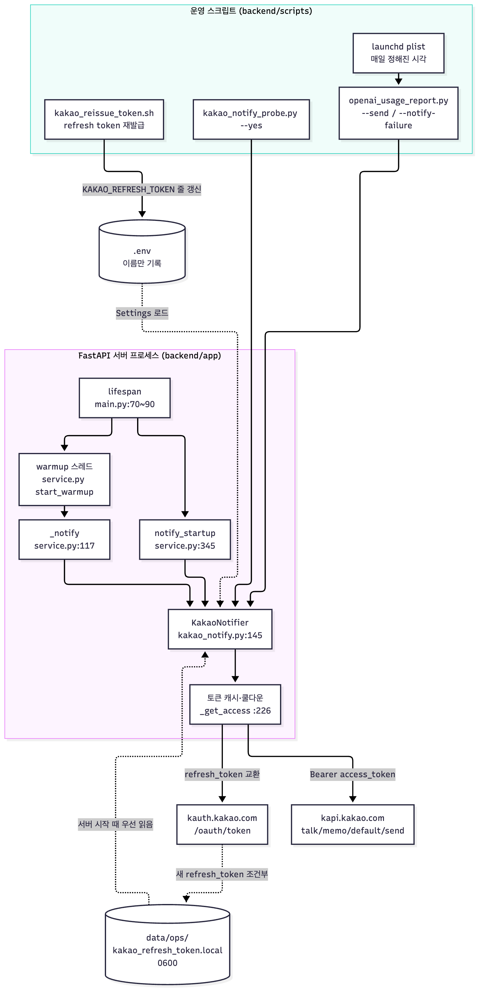
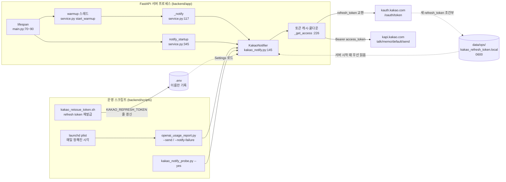
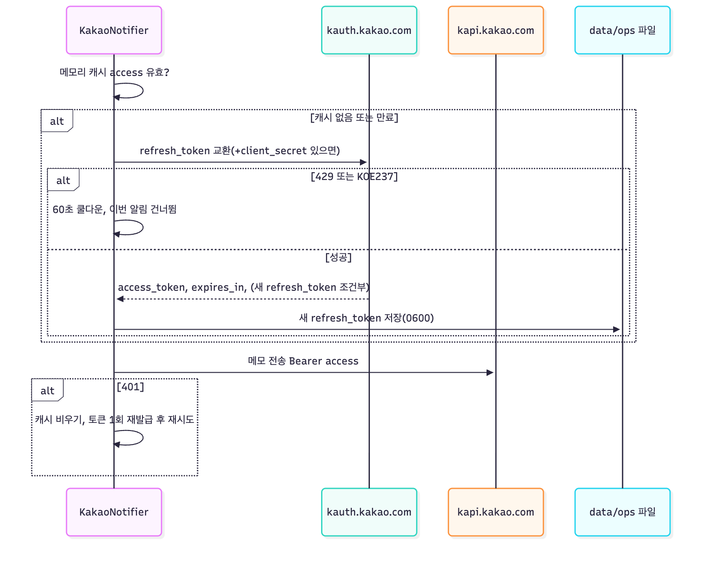
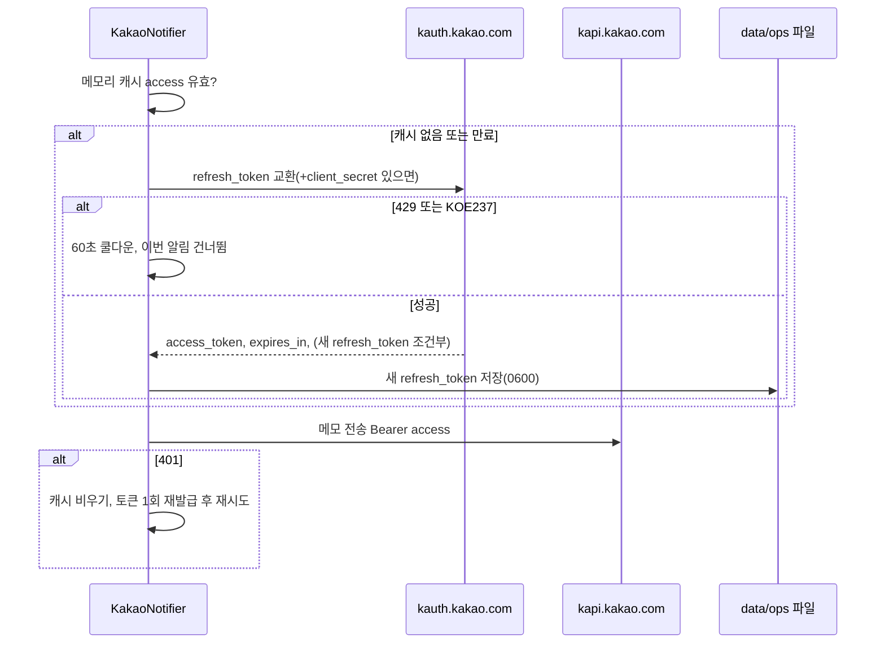

# 카카오톡 운영 알림 구축 파이프라인

**NOTICE PIPELINE: 카카오톡 "나에게 보내기" 운영 알림 아키텍처**

- 기준일: 2026-11-25 (코드는 `develop` 작업 트리를 읽기만 했다. 실행하거나 전송하지 않았다)
- 성격: DevOps 트랙의 운영 알림 설명 문서. 채널 결정은 BE-13-12 A(2026-11-22), 서버 시작 알림은 사용자 요청(2026-11-24)에 따른다
- 원칙: **키·토큰 값은 이 문서와 코드 어디에도 쓰지 않는다.** 환경변수는 이름만 적는다. `.env`는 열지 않았다(이름 확인은 코드의 `Settings` 선언으로 했다)
- 근거: `backend/app/api/kakao_notify.py`, `backend/app/api/service.py`, `backend/app/main.py`, `backend/app/config.py`, `backend/scripts/*`, `tickets/backend/BE-13.md`

## Index
- [1. 개요](#1-개요)
- [2. 구조도](#2-구조도)
- [3. 알림 종류와 발신 지점](#3-알림-종류와-발신-지점)
- [4. 토큰 흐름과 갱신](#4-토큰-흐름과-갱신)
- [5. 실패 처리 원칙](#5-실패-처리-원칙)
- [6. 설정과 스위치](#6-설정과-스위치)
- [7. 운영 절차](#7-운영-절차)
- [8. 한계와 미결](#8-한계와-미결)
- [9. 용어 설명](#9-용어-설명)
  - [(1) launchd](#1-launchd)

## 1. 개요

### (1) 무엇을 알리는가
- **서버 준비 단계**: 백그라운드 준비(warmup)의 코퍼스 완료·전체 완료·실패
- **서버 시작 완료**: lifespan 시작 끝 직전 1회
- **비용 보고**: 전날 OpenAI 사용량을 매일 보고(`openai_usage_report.py --send`)
- **보고 실패**: 비용 보고가 실패하면 실패 종류만 알림(`--notify-failure`)

### (2) 설계 원칙
| 원칙 | 코드 근거 |
|---|---|
| 알림이 서버를 막지 않는다 | 별도 데몬 스레드에서 보내고 예외를 모두 삼킨다(`kakao_notify.py:180`·`:187`) |
| 민감 값을 남기지 않는다 | 로그는 예외 **종류 이름**과 HTTP 상태·`error_code`만 남긴다(`:98`·`:88`) |
| 사용자 데이터를 보내지 않는다 | 메시지는 접두·브랜치·단계 이름·초·개수만 담는다(`:136`, 200자 제한) |
| 설정이 없으면 조용히 끈다 | 키·토큰이 없거나 `MEDIAGENT_NOTIFY`가 꺼지면 `from_settings`가 None(`:165`) |

## 2. 구조도

구조도: 아래 Mermaid 원본으로 다시 그릴 수 있다.

읽는 법:
- 발신은 세 갈래다. 서버 내부(warmup·시작 완료)는 `service.py`의 `_notify`·`notify_startup`을 거치고, 운영 스크립트(비용 보고·시험)는 `KakaoNotifier`를 직접 쓴다.
- 토큰 교환과 메모 전송은 모두 `KakaoNotifier` 한 클래스에 모여 있다.
- 점선은 조건부 경로다. 새 refresh token은 카카오가 줄 때만 저장된다.

## 3. 알림 종류와 발신 지점

| 알림 | 메시지 예 | 발신 지점 | 조건 |
|---|---|---|---|
| 서버 시작 완료 | `[MediAgent-Can-I-PPiyak] [브랜치] 서버 시작 완료` | `service.py:345`~`:351`, lifespan이 `yield` 직전 호출(`main.py:90`) | 실행기 있음, 키 있음 |
| 코퍼스 준비 완료 | `… corpus 완료 12.3s` | `service.py:141`~`:142` | warmup 스레드, 라벨이 `corpus`로 시작 |
| 준비 완료 | `… warmup 완료 29.2s` | `service.py:280`~`:281` | warmup 성공 |
| 준비 실패 | `… warmup 실패 TypeError 3.1s` | `service.py:275`~`:276` | 예외 **종류 이름**만 |
| 비용 보고 | 전날 사용량 요약 | `openai_usage_report.py:320`~`:328`, `send_now` 동기 | `--send`, 종료 코드 2는 설정 없음 |
| 비용 보고 실패 | `OpenAI 비용 보고 실패(<종류>)` | `openai_usage_report.py:280`~`:282` | `--notify-failure` |

- 요청 경로(`resources`)에서는 알리지 않는다. `NOTIFIER`는 warmup 스레드에서만 켠다(`service.py:114`, 주석 "요청 경로에서는 알리지 않는다").
- 메시지 접두는 `[MediAgent-Can-I-PPiyak]`이고 브랜치 이름이 붙는다(`kakao_notify.py:136`). 브랜치는 프로세스당 한 번 `git rev-parse`로 읽어 캐시한다(`:127`).

## 4. 토큰 흐름과 갱신

토큰 흐름: 아래 Mermaid 원본으로 다시 그릴 수 있다.

| 단계 | 코드 | 설명 |
|---|---|---|
| 캐시 | `_get_access` `kakao_notify.py:226`~`:241` | 잠금 안에서 한 번만 요청. 만료 5분 전(`TOKEN_SAFETY_SECONDS`)부터 새로 받음 |
| 쿨다운 | `:236`·`:73`·`COOLDOWN_SECONDS` 60초 | 2026-11-24 서버 시작 3건 연속 실패(KOE237, 속도 제한) 뒤 추가. 토큰 요청만 쉰다 |
| 재시도 | `send_now` `:195`~`:206` | 메모 401이면 토큰을 버리고 한 번만 재시도 |
| 저장 우선 | `from_settings` `:165`~`:179` | 저장 파일의 토큰이 있으면 `.env` 값보다 우선한다(카카오가 준 새 토큰을 쓰기 위해) |
| 회전 저장 | `_request_token` `:243`·`_save` `:268` | 카카오가 새 refresh_token을 줄 때(남은 기간 1개월 미만)만 `data/ops/kakao_refresh_token.local`에 0600으로 쓴다 |

## 5. 실패 처리 원칙

- **삼키기:** `_safe_send`가 모든 예외를 잡는다(`kakao_notify.py:187`~`:192`). 실패는 경고 로그 한 줄이다.
- **값 비노출:** `_http_error`가 응답 본문을 한 번만 읽어 `error_code`(영숫자 40자 이하)만 취하고, 원 예외를 잇지 않는다(`:88`~`:95`, `:208`~`:212`).
- **타임아웃:** 요청당 3초(`TIMEOUT_SECONDS`).
- **시험:** `backend/tests/test_kakao_notify.py`가 32개 시험 함수로 위 동작을 고정한다(가짜 전송 함수 주입, 실제 호출 없음).

## 6. 설정과 스위치

| 이름 | 종류 | 선언 | 쓰는 곳 |
|---|---|---|---|
| `KAKAO_REST_API_KEY` | 비밀 | `config.py:120` (`SecretStr`) | 토큰 교환 |
| `KAKAO_CLIENT_SECRET` | 비밀, 선택 | `config.py:121` | 앱에서 클라이언트 시크릿을 켠 경우만 |
| `KAKAO_REFRESH_TOKEN` | 비밀 | `config.py:122` | 저장 파일이 없을 때의 초기 값 |
| `MEDIAGENT_NOTIFY` | 스위치(비밀 아님) | `config.py:123`, 기본 켬 | `0`·`false`·`off`면 끔 |
| `MEDIAGENT_WARMUP` | 스위치 | `config.py:51` | 끄면 warmup 알림도 없음 |

- 키가 없으면 알림 기능 전체가 꺼진다. 서버는 정상 시작한다(`from_settings`가 None).
- 이 변수들은 `Settings`에 선언돼 있어 **루트 `.env`에 둔다**. 재발급 스크립트의 Redirect URI(`KAKAO_REDIRECT_URI`)만 셸 환경에 둔다(`.env`에 넣으면 설정 로드가 실패한다).

## 7. 운영 절차

1. **시험 전송:** `backend/`에서 `python scripts/kakao_notify_probe.py --yes`(`--yes` 없이는 설정 상태만 출력). 성공·실패와 예외 종류만 나온다.
2. **refresh token 재발급(약 2개월마다):** `bash backend/scripts/kakao_reissue_token.sh`. 인가 주소를 열고 사용자가 붙여 넣은 주소를 토큰으로 교환해 `.env`의 `KAKAO_REFRESH_TOKEN` 줄을 교체한다. 값은 출력하지 않는다. 사전 조건: 카카오 개발자 콘솔 Redirect URI와 `talk_message` 동의항목.
3. **비용 보고 자동화:** `backend/scripts/launchd/install_usage_report.sh --yes`가 plist 템플릿을 설치한다(사용자가 직접 실행, 매일 정해진 시각). 설치는 사용자가 한다.
4. **운영 전 확인:** 서버 기동 후 "서버 시작 완료"와 "warmup 완료"가 두 번 오는지 본다. 한 번 실패하면 로그 한 줄의 종류 이름으로 원인을 좁힌다.

## 8. 한계와 미결

- **토큰 만료:** refresh token은 약 2개월 유효하다. 만료되면 알림이 조용히 멈춘다(실패 로그만 남는다). 만료 알림 장치는 없다(미결).
- **저장 파일 권한:** 0600이지만 로컬 Mac 파일이다. 배포 환경(로컬 상시 + 터널)에서 같은 방식이 맞는지 BE-13에서 다시 본다.
- **발신 실패의 사용자 인지:** 실패는 서버 로그에만 남는다. 알림이 가지 않은 사실 자체는 사람이 로그를 봐야 안다.
- **쿨다운 중 누락:** 60초 쿨다운 동안 온 알림은 건너뛴다(재시도 큐 없음, 의도된 단순화).
- **미확인:** 운영 중 실제 전송 성공률은 측정하지 않았다. 2026-11-24 시작 실패 3건 뒤 쿨다운을 넣었다는 기록만 있다.
- **BE-13 연결:** `tickets/backend/BE-13.md` 59행의 "서버 가동 알림"은 `/health` 확인 뒤 래퍼 스크립트로 보내는 안이었다. 실제 구현은 서버 코드(lifespan)에 넣었다. 두 방식의 차이를 BE-13 결정 기록에 남길지 미정이다.

## 9. 용어 설명

### (1) launchd
- **무엇인가**: macOS의 기본 작업 스케줄러이자 서비스 관리자다. 사용자가 로그인해 있는 동안(또는 부팅 뒤) 정해진 시각에 명령을 실행하고, 실패하면 다시 띄우는 역할을 한다. Linux의 systemd timer·cron에 해당한다.
- **어떻게 설정하나**: 작업은 **plist**(XML 설정 파일)로 적는다. 이 프로젝트의 템플릿은 `backend/scripts/launchd/com.mediagent.openai-usage-report.plist.template`이다.
  - `Label`: 작업 이름(`com.mediagent.openai-usage-report`)
  - `ProgramArguments`: 실행할 명령(파이썬 경로, `openai_usage_report.py`, `--send --notify-failure`)
  - `StartCalendarInterval`: 매일 12:00 실행
  - `EnvironmentVariables`: `TZ=Asia/Seoul`로 시각대를 고정
  - `StandardOutPath`·`StandardErrorPath`: 출력과 오류를 `logs/openai_usage_report.launchd.log`에 남긴다
- **등록 방법**: `install_usage_report.sh`가 템플릿의 `@PYTHON@`·`@REPO_ROOT@`를 실제 경로로 바꿔 `~/Library/LaunchAgents/`에 쓰고, `launchctl bootstrap gui/<사용자 번호>`로 등록한다. 기본은 계획만 출력하고, `--yes`를 줘야 실제로 설치한다.
- **확인·제거**: `launchctl print gui/<사용자 번호>/com.mediagent.openai-usage-report`로 상태를 보고, `install_usage_report.sh --uninstall --yes`로 제거한다.

#### 파이썬 의존성인가?
- **아니다.** launchd는 macOS 운영체제에 들어 있는 기능이고 pip로 설치하는 파이썬 패키지가 아니다. `backend/pyproject.toml`에도 launchd 관련 항목이 없다.
- 파이썬과 관련된 부분은 **실행 대상**이다. plist의 `ProgramArguments`가 `backend/.venv/bin/python`(프로젝트 가상환경의 인터프리터)을 부르고, 그 스크립트가 `app.api.kakao_notify`, `app.config` 같은 앱 모듈을 쓴다. 즉 launchd는 "언제 실행할지"만 맡고, 실제 로직은 파이썬 코드다.
- 가상환경이 없으면 설치 스크립트가 경고하고 설치하지 않는다(`install_usage_report.sh`).
- 파이썬 쪽 의존성은 HTTP 호출을 표준 라이브러리(`urllib`)로 하므로 카카오 알림 경로에는 외부 패키지가 필요 없다.

#### 알림은 어떻게 전송되나 (비용 보고 기준)
1. **12:00**: launchd가 설정된 명령을 실행한다. 환경 변수 `TZ`로 시각대는 서울 시각이다.
2. **스크립트 실행**: `backend/.venv/bin/python backend/scripts/openai_usage_report.py --send --notify-failure`가 시작된다.
3. **사용량 조회**: 관리자 키(`OPENAI_ADMIN_KEY`)로 OpenAI Costs API를 불러 전날 사용량을 계산한다.
4. **알림 객체 생성**: `KakaoNotifier.from_settings()`가 `.env`의 `KAKAO_REST_API_KEY`·`KAKAO_REFRESH_TOKEN` 등을 읽어 만든다(키가 없으면 종료 코드 2).
5. **토큰 교환**: refresh token으로 카카오 `kauth` 주소에서 access token을 받는다(4장 참고).
6. **메모 전송**: access token으로 카카오 `kapi` 메모 API를 호출해 "나에게 보내기" 메시지를 보낸다. `--notify-failure`를 켠 경우 보고가 실패하면(카카오 전송 실패는 제외) 실패 종류만 담은 메시지를 보낸다(`openai_usage_report.py:280`~`:282`).
7. **기록**: 결과는 `logs/openai_usage_report.log`에 한 줄로 남고, launchd의 표준 출력·오류는 `…launchd.log`에 남는다.

- 이 경로는 **서버 시작 알림과 별개**다. 서버 준비 알림(warmup, 시작 완료)은 FastAPI 프로세스가 직접 보내고 launchd를 쓰지 않는다(2장 구조도 참고).
- **트리거 구분**: 알림을 "언제 보낼지" 정하는 주체는 두 가지다.
  - **운영체제 의존(macOS launchd)**: 매일 비용 보고 1건뿐이다. 시각을 맥의 작업 스케줄러가 정하므로, 맥이 아닌 서버로 옮기면 plist 대신 cron 등으로 다시 등록해야 한다.
  - **운영체제 비의존(파이썬 코드)**: 서버 시작 완료와 warmup 완료·실패는 FastAPI의 lifespan과 백그라운드 스레드가 발생시킨다(`main.py:90`, `service.py:280`~`:281`). 같은 코드가 Linux 등 다른 환경에서도 실행된다. 다만 브랜치 이름을 읽는 `git rev-parse`는 git이 있어야 하고, 없으면 `unknown`으로 표시한다(`kakao_notify.py:117`~`:124`).
  - 따라서 "서버 운영체제 의존성으로 이벤트가 발생한다"는 **비용 보고에만 해당**한다. 서버 상태 알림은 OS와 무관하다.
- 맥이 잠자기 중이었던 시각의 작업을 깨어난 뒤 실행하는지는 이 문서에서 검증하지 않았다(미확인). 이 한계는 8장 미결 항목에 덧붙인다.
