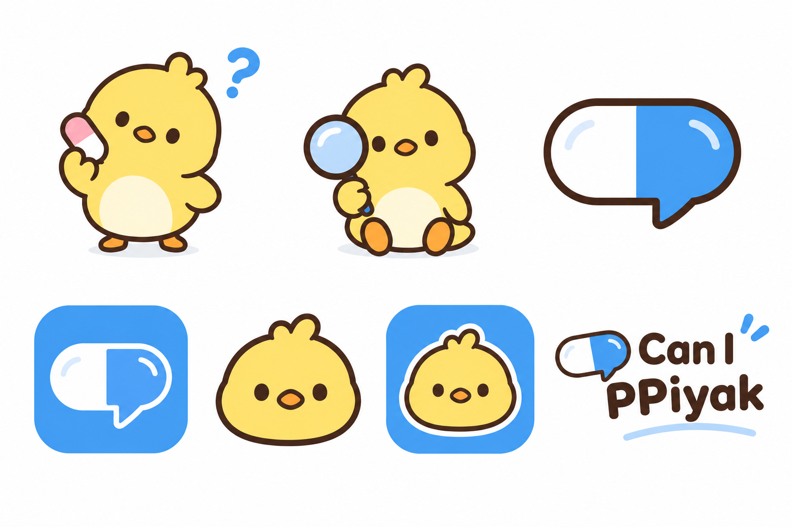

# FE-06 · 브랜드 이미지 자산(로고·앱 아이콘·마스코트) GPT 생성

## Index
- [1. 이슈](#1-이슈)
- [2. 완료 조건](#2-완료-조건)
- [3. 자산 목록과 사용 위치](#3-자산-목록과-사용-위치)
  - [3.1 생성 결과와 용도 배정(2026-11-07)](#31-생성-결과와-용도-배정2026-11-07)
  - [3.2 파일 이름과 사용 위치(2026-11-18)](#32-파일-이름과-사용-위치2026-11-18)
- [4. 이전 가이드(PRD-06 §5.5 원문)](#4-이전-가이드prd-06-55-원문)
- [5. 프롬프트 키트(초안)](#5-프롬프트-키트초안)
- [6. 검수 체크리스트](#6-검수-체크리스트)
  - [6.1 1차 점검 결과(시트)](#61-1차-점검-결과시트)
- [7. 결정 현황](#7-결정-현황)
- [8. 하위 작업](#8-하위-작업)
- [9. 관련](#9-관련)
- [10. 메모](#10-메모)

## 1. 이슈
서비스 표시 이름 Can I PPiyak(PRD-06-01)에 쓸 로고 심볼, 앱 아이콘(favicon), 병아리 마스코트 컷 이미지를 **GPT 이미지 생성에 의뢰해 만든다**(사용자 결정 2026-11-03, 지시 2026-11-07). 이전에 PRD-06 §5.5에 생성 프롬프트 가이드(초안)와 §5.2~5.4에 사용 규칙을 적어 두었으나 실제 이미지를 만드는 작업 티켓이 없어 별도로 분리한다. Agent-RAG 핵심이 아니므로 시간을 쓰지 않는 소규모 작업이다(요소당 후보 3~4장 중 1장 선택). 이미지는 FE-01 화면 구현 전에 필요하다.

## 2. 완료 조건
- [x] (사용자 눈 확인 완료, [FE-08 §2](FE-08.md#2-완료-조건) 2.2-1 예·2.2-4 통과, 2026-11-18) 마스코트 컷 A(질문형)와 B(빈 상태·로딩·오류) 각 1장이 §6 검수 체크리스트를 모두 통과해 선택되어 있다.
- [x] (사용자 눈 확인·글자 예외 동의 완료, FE-08 2.2-4 통과·2.2-5 동의, 2026-11-18) (FE-06-01 A) 로고(2열 오른쪽)와 앱 아이콘·favicon이 병아리 없는 캡슐 말풍선 심볼이고 §6 체크리스트를 통과한다(로고 이미지의 글자는 §3.1 예외).
- [x] (파일 32·180·192·512 있음·512는 확대라 흐림, 사용자 눈 확인 완료: FE-08 2.2-2 예·2.2-3 예, 512 흐림 감수 FE-06-04 A, 2026-11-18) (FE-06-01) favicon·앱 아이콘이 로고 시트(`images/logo_can_i_ppiyak.png`) 2열 오른쪽의 **캡슐 말풍선 심볼 부분만**(글자·밑줄 제외) 잘라 32·180·512px로 줄인 파일에서 형태가 알아보인다(눈으로 확인).
- [x] (2026-11-18 `HomeHero.tsx:9`, FE-01 §2 FE-06-01 항목 `[x]`) (FE-06-01) 1열 왼쪽 질문 병아리가 시작 화면의 메인 이미지로 잘려 있다(앱 아이콘·favicon이 아님).
- [x] (FE-06-07 A, 2026-11-18 조건 정정) 확정본만 `frontend/public/brand/`·`src/app/`에 저장되어 커밋되어 있다(커밋 `eaea034`). 후보는 시트 1장뿐이고 원본은 `images/logo_can_i_ppiyak.png`에 추적 유지한다(`data/mock/brand/` 폴더는 없음, 옛 조건 "후보는 로컬 `data/mock/brand/`에만"은 현실과 달라 정정).
- [x] (FE-06-06 A, 2026-11-18) 사용한 도구·날짜·프롬프트·선택한 후보가 §10 메모에 기록되어 있다(README 반영은 PRD-04). 프롬프트는 §5 키트 내용 그대로였다는 사용자 확인을 §10에 적었다.
- [x] 파일 이름과 사용 위치 표(§3.2, 2026-11-18)가 FE-01·FE-02에 전달되어 있다(FE-01·02·04·05에 FE-06-01 항목이 이미 있고 파일 표는 §3.2).
- [x] 이미지 이용 조건 미확인 사실이 법률 검토 보류 목록(Recap 표)에 한 줄 남아 있다(`schedule.md` Recap 9 "GPT 생성 이미지(FE-06) 이용 조건", 2026-11-18 확인).

## 3. 자산 목록과 사용 위치
| 자산 | 용도 | 사용 화면 | 규칙 |
|---|---|---|---|
| 로고 심볼 | 헤더(심볼만)·README 첫머리·발표 표지 | 모든 화면 상단(응급·금기 포함) | 화면 헤더의 서비스 이름 Can I PPiyak은 웹폰트 텍스트다. 이미지 안의 글자는 정적 브랜딩 자리(README·발표 표지·소개)에만 쓴다(§3.1 예외). 응급·금기·고정 문구 화면에서 위험 신호를 가볍게 보이게 하는 요소(병아리, 귀여운 얼굴, 체크 표시)를 쓰지 않는다 → FE-06-01 A |
| 앱 아이콘·favicon | 브라우저 탭, 홈 화면 | 항상 | **출처: 시트 2열 오른쪽 로고(`images/logo_can_i_ppiyak.png`)에서 캡슐 말풍선 심볼 부분만 잘라 쓴다**(글자·밑줄 제외). 32·180·512px에서 알아볼 것. 병아리를 쓰지 않는다(FE-06-01 A) |
| 마스코트 컷 A(질문형) | 시작 화면, 되묻기 카드(작게) | PRD-06-02 보조 자리 | 병아리가 약을 들고 고개를 갸웃. 약을 입에 넣는 장면 금지 |
| 마스코트 컷 B(빈 상태·로딩·오류) | 빈 상태, 로딩, 오류 | 보조 자리 | 단순 선·평면 색 |

- "삐!" 경고 표지는 **생성하지 않는다**(글자·아이콘을 코드가 그린다, PRD-06-03, FE-02).
- 마스코트 사용 금지 화면: 금기 발견·주의 결과, "금기 목록에 없음"·근거 없음, 응급(119), 고정 문구·면책(PRD-06-02).

### 3.1 생성 결과와 용도 배정(2026-11-07)
사용자가 GPT로 이미지 한 장(시트)을 만들었다: `images/logo_can_i_ppiyak.png`(1536×1024, 2행 × 3칸 배치, 아래 그림). 사용자 배정(2026-11-07)과 FE-06-01 답(2026-11-07, A + 추가 지시)을 반영해 적는다. 행·열은 사용자 표현대로 위쪽 줄이 1열, 아래쪽 줄이 2열이다.



| 위치 | 그림 | 사용자가 정한 용도 | 쓰는 자리(PRD-06-02 보조 자리 기준) | 점검 |
|---|---|---|---|---|
| 1열 왼쪽 | 약(분홍·흰 캡슐)을 든 채 고개를 갸웃하는 병아리와 파란 물음표 | **메인 이미지**(시작 화면 대표, §3 마스코트 컷 A, 보조 자리) | 시작 화면(2열 오른쪽 로고와 함께 구성), 되묻기 카드(작게) | 약은 얼굴 옆에 들고 입에 넣지 않았다. 물음표는 의도된 기호다. 앱 아이콘·favicon이 아니다(FE-06-01 추가 지시, 해석은 아래 열린 질문 ①) |
| 1열 가운데 | 돋보기를 든 앉은 병아리 | **검색**: Agent가 도구를 호출(tool-calling)하는 동안의 진행 표시 | 로딩·진행 화면(§3 마스코트 컷 B) | 119 안내·금기 결과·"금기 목록에 없음"이 나온 뒤에는 쓰지 않는다(로딩이 끝나면 사라짐) |
| 1열 오른쪽 | 파랑·흰 캡슐에 말풍선 꼬리가 붙은 큰 그림(캡슐 말풍선) | **의약품 관련 부분** 아이콘(**확정(2026-11-12, FE-IMPL-07): `MedIcon variant="pill"`로만 쓰는 의약품 아이콘이고 마스코트가 아니다**) | 약 목록, 확인·수정 카드의 약 항목, 제품 정보 영역 | 체크 표시·십자·경고 요소가 없어 중립이다 |
| 2열 왼쪽 | 캡슐 말풍선을 파란 라운드 정사각형에 넣은 아이콘 | **의약품 관련 아이콘 전용**(정사각 아이콘 모양, 기본값) | 위와 같음. 앱 아이콘·favicon 원본이 아니다(그것은 2열 오른쪽 로고 심볼) | 32px 판독은 크롭 뒤 확인 |
| 2열 가운데 | 병아리 얼굴만 있는 그림과, 같은 얼굴이 파란 라운드 정사각형 안에 있는 그림 | **프로필 설정 기본 이미지**: 본인·자녀·부모를 나타낼 때 | FE-04 온보딩·프로필 화면(위험 정보와 무관한 자리) | 프로필 화면은 PRD-06 §5.3 표에 없는 자리다 → 보조 자리로 보는 것은 **가정**이다(아래) |
| 2열 오른쪽 | 캡슐 말풍선 심볼 + 글자 "Can I PPiyak" + 파란 밑줄 | **로고 + favicon·앱 아이콘 원본**(심볼 부분만 크롭) | 시작 화면(메인 이미지와 함께), README 첫머리, 발표 표지, 로그인·소개 같은 정적 브랜딩 자리. 탭·홈 화면 아이콘은 심볼 부분만 | 병아리가 없어 FE-06-01 A와 같은 방향이다. **이미지 안에 글자가 있다**(아래 예외). favicon은 글자·밑줄을 뺀 심볼만 쓴다 |

**점검에서 드러난 것**
- **글자 예외**: PRD-06 §5.5는 "글자는 이미지에 넣지 않는다"인데 로고 시트에는 "Can I PPiyak"이 들어 있다. 눈으로 보면 철자가 맞게 그려졌다(확대해 철자 확인은 하위 작업). 따라서 이 이미지는 **정적 브랜딩 자리에만** 쓰고(favicon은 심볼만 잘라 쓰므로 글자가 없다), 화면 헤더의 서비스 이름은 웹폰트 텍스트로 둔다(접근성·번역·깨짐 방지). 체크리스트 §6의 "글자 없음"은 이 로고 이미지에는 적용하지 않는다고 사용자 확인을 받는다.
- **FE-06-01과의 관계(결정됨, 2026-11-07 A)**: 로고와 앱 아이콘·favicon은 병아리 없는 캡슐 말풍선 심볼이다. 시트의 병아리 얼굴 앱 아이콘 후보(2열 가운데 오른쪽)는 앱 아이콘으로 쓰지 않고 프로필 기본 이미지 자리(보조)에만 쓴다. 사용자 추가 지시 원문: "다만 1열 왼쪽이 메인 이미지 + 2열 오른쪽. 파비콘은 2열 오른쪽으로 하자."
- **로딩 마스코트와 응급**: 검색 병아리는 로딩 중에만 보이고, 응급 키워드가 있으면 119 안내가 맨 위에 먼저 나온다(H4). 119 영역과 같은 줄·같은 카드에 두지 않는다.
- **시트 분할 필요**: 이미지는 한 장에 7개 그림이 있어 쓰려면 잘라야 한다. 대략 위치(1536×1024 기준, 눈대중이라 크롭 뒤 확인): 질문 병아리 x110–510·y95–500, 돋보기 병아리 x585–935·y120–500, 큰 캡슐 말풍선 x1050–1440·y185–450, 캡슐 앱 아이콘 x60–370·y590–885, 병아리 얼굴 x415–705·y605–880, 병아리 앱 아이콘 x745–1040·y590–885, 로고 x1070–1500·y605–860.

**열린 질문(결정 아님, 사용자 확인)**
1. (**해석, 사용자 확인 필요**) "1열 왼쪽이 메인 이미지 + 2열 오른쪽"을 **시작 화면 구성**(왼쪽 질문 병아리 + 오른쪽 로고)으로 읽었다. "파비콘은 2열 오른쪽"은 로고의 캡슐 말풍선 심볼 부분만 잘라 쓰는 것으로 읽었다(32px에서 글자는 읽을 수 없고 PRD-06 §5.5 글자 규칙도 지키기 위해 글자·밑줄 제외). 앱 아이콘(180·512px)도 같은 심볼을 쓴다. 틀리면 알려 주기. (옛 질문 ①은 이 해석으로 해소)
2. **(답 완료, 2026-11-12 FE-06-02 A)** 프로필 기본 이미지(병아리 얼굴)는 본인·자녀·부모에 **같은 그림으로** 쓰고 이름 글자로 구분한다. (PRD는 본인 + 가족 1명까지, FE-04)
3. (기본값으로 정리, 사용자 확인 가능) 캡슐 말풍선 정사각 아이콘(2열 왼쪽)은 favicon을 로고에서 잘라 쓰게 되었으므로 **의약품 관련 아이콘 전용**으로 쓴다.
- 프로필 화면(FE-04)의 병아리 얼굴과 로고·favicon 규칙은 PRD-06 §5.3 표에 한 줄씩 더했다(2026-11-07, 결정 번호·상태는 그대로).

### 3.2 파일 이름과 사용 위치(2026-11-18)
| 파일(`frontend/`) | 크기(px) | 부품 | 지금 쓰는 곳 |
|---|---|---|---|
| `public/brand/mascot-question.png` | 402×411 | `Mascot question` | 시작 화면(`HomeHero`), 여는 화면(`Splash`) |
| `public/brand/mascot-search.png` | 347×388 | `Mascot search` | 진행 표시(`ProgressSteps`), 오류(`ErrorState`). 119가 뜨면 숨김 |
| `public/brand/symbol.png` | 160×114 | `BrandLogo` | 시작 화면, 사이드바, 좁은 폭 머리줄 |
| `public/brand/logo.png` | 428×260 | `BrandWordmark` | 여는 화면만(글자 이미지) |
| `public/brand/icon-pill.png` | 396×267 | `MedIcon pill` | 미리보기만(약 항목 자리 대기) |
| `public/brand/icon-pill-square.png` | 311×300 | `MedIcon square` | 미리보기만 |
| `public/brand/face.png` | 295×270 | `Mascot face` | 미리보기만(FE-04 대기) |
| `public/brand/face-square.png` | 301×302 | `Mascot face-square` | 미리보기만(FE-04 대기) |
| `public/brand/icon-192.png`·`icon-512.png` | 192·512 정사각 | manifest | 설치 아이콘 |
| `src/app/icon.png` | 32×32 | favicon | 브라우저 탭 |
| `src/app/apple-icon.png` | 180×180 | iOS 홈 화면 | 흰 배경(FE-06-03 A) |

크기는 `FE-IMPL-07` 보고 값이고 사용처는 2026-11-18 `frontend/src` 검색 결과다(근거 `data/mock/briefs/reports/goal-fe67.md`, 로컬). 2026-11-18 자산 점검(`goal-fe2.md` §8): 12개 파일 모두 PNG·150KB 이하, 32·180·512 세 크기 있음, 배경은 마스코트·심볼이 투명이고 앱 아이콘 180·192·512는 흰색 불투명, 마스코트 금지 영역(119·결과·고정 안내)에 마스코트 0개(`mascot-zones.test.tsx`, e2e `brand.spec.ts`). 글자 유무·형태 판독은 사람 확인이다([FE-08 §2](FE-08.md#2-완료-조건) 2.2).

## 4. 이전 가이드(PRD-06 §5.5 원문)
`tickets/doc/PRD-06.md` §5.5 "제작 방법과 라이선스"의 내용을 그대로 옮긴다.

> **결정(사용자, 2026-11-03): 이미지는 GPT(OpenAI의 이미지 생성)를 활용해 만든다.** 이미지 제작은 Agent-RAG 핵심이 아니므로 시간을 쓰지 않도록 단순한 모양 1~2컷으로 한다.
>
> - **이용 조건**: 생성 이미지의 이용 약관은 이 티켓에서 확인하지 않았다(미확인). 비상업 포트폴리오 용도이므로 영향은 작다고 보지만, 약관의 이용 범위는 사용자가 필요하면 확인한다.
> - **생성 프롬프트 가이드(초안)**: §5.2~5.4의 규칙을 프롬프트에 반영한다.
>   - 병아리가 **약을 들고 고개를 갸웃하는 질문형** 모양으로 한다. **약을 입에 넣는 장면은 만들지 않는다**(복용 권유로 읽힐 수 있음).
>   - 알약·캡슐은 **일반적인 모양**으로 하고 실제 제약사 상표·제품 포장·로고를 그리지 않는다.
>   - **글자는 이미지에 넣지 않는다.** "삐!" 표지와 서비스 이름은 화면의 텍스트·아이콘으로 코드가 그린다(생성 이미지의 글자는 깨지기 쉬움).
>   - 단순한 선·평면 색으로 작은 크기(아이콘·빈 상태 그림)에서도 알아볼 수 있게 한다.
> - **기록**: 사용한 도구·날짜·프롬프트를 이 티켓 메모나 README에 남긴다(출처 표기, 재현).
> - 마스코트 사용 범위는 §5.3, "삐!" 표지는 §5.4가 우선한다.

## 5. 프롬프트 키트(초안)
GPT 이미지 생성에 붙여 넣는 영문 프롬프트다. 키트는 초안이며 결과가 마음에 안 들면 사용자가 고쳐 쓴다. 이 티켓에서 확정되는 것은 규칙(§3)과 체크리스트(§6)다.

**공통 스타일 블록**(모든 프롬프트 끝에 붙인다):
```
flat vector-style illustration, simple clean rounded lines, solid flat colors, limited palette of warm yellow, soft white and one calm blue accent, no text, no letters, no numbers, no brand names, no logos, plain white background, centered subject, generous margin, still readable at 64 pixels
```

1. **마스코트 A(질문형)**: 약을 들고 고개를 갸웃하는 병아리.
   ```
   A cute small yellow baby chick holding a generic white and pink capsule in one wing, head tilted to the side with a curious, gentle expression, the capsule is held away from its beak, friendly and calm, not smiling broadly
   ```
   피할 것: 약을 입에 넣는 모양, 웃는 얼굴로 약을 권하는 모양, 포장·상표.
2. **마스코트 B(빈 상태·로딩)**: 돋보기를 든 차분한 병아리.
   ```
   The same small yellow baby chick sitting quietly with a small magnifying glass, looking at the viewer, simple and neutral
   ```
3. **로고 심볼(FE-06-01 A 기준, 병아리 없음)**: 캡슐 모양 말풍선. **이미 생성됨**(시트 2열 오른쪽 로고, 2026-11-07). 아래 프롬프트는 재생성이 필요할 때만 쓴다.
   ```
   A minimalist rounded capsule shape that is also a speech bubble, two soft tones of blue and white, calm and neutral, no check mark, no cross, no warning triangle, no face
   ```
   FE-06-01은 A로 결정되어 병아리 변형(B)은 쓰지 않는다.
4. **앱 아이콘·favicon**: 시트 로고에서 심볼 부분만 잘라 쓰므로(FE-06-01) 새로 생성하지 않는다. 재생성이 필요할 때만 아래 문구를 쓰고, 생성 후 32·180·512px로 줄여 판독을 확인한다.
   ```
   a single bold simplified version of the logo symbol centered on a rounded square, two colors only
   ```
5. **생성 요청 방법(사용자 몫, 재생성 시)**: 각 프롬프트(1~4번)에 공통 블록을 붙여 GPT 이미지 생성에 넣고 후보 3~4장 중 §6 체크리스트를 통과한 것 1장을 고른다. 한 번에 한 가지 요소만 고쳐 다시 요청한다(예: 표정만). 결과·프롬프트·날짜를 §10 메모에 적는다.

## 6. 검수 체크리스트
아래를 모두 통과해야 쓴다.
- [x] 이미지 안에 글자·숫자·가짜 글자가 없다. (FE-08 2.2-4 통과, 사용자 확인 2026-11-18)
- [x] 실제 제약사 상표·제품 포장·로고가 없다. (FE-08 2.2-4 통과, 사용자 확인 2026-11-18)
- [x] 약을 입에 넣는 장면이 없다(복용 권유). (FE-08 2.2-4 통과, 사용자 확인 2026-11-18)
- [x] 체크 표시·방패·"안전" 신호로 읽히는 요소가 없다. (FE-08 2.2-4 통과, 사용자 확인 2026-11-18)
- [x] 경고 삼각형·느낌표처럼 "삐!" 경고 표지와 겹치는 요소가 없다. (FE-08 2.2-4 통과, 사용자 확인 2026-11-18)
- [x] 64px와 32px로 줄여도 형태가 알아보인다. (FE-08 2.2-2 예, 사용자 확인 2026-11-18)
- [x] 배경이 단색이라 잘라 쓸 수 있다. (FE-08 2.2-4 통과, 사용자 확인 2026-11-18)
- [x] 사람 얼굴·특정 인물·유명 캐릭터와 닮지 않았다. (FE-08 2.2-7 없음, 사용자 확인 2026-11-18)
- [x] 마스코트 사용 금지 화면(§3)에 쓰는 계획이 없다. (FE-08 2.2-4 통과, 사용자 확인 2026-11-18)

### 6.1 1차 점검 결과(시트)
작업자가 눈으로 본 결과이며 **사용자 확인이 필요했고 2026-11-18 FE-08 2.2에서 확인을 마쳤다**. (2026-11-18 사용자가 FE-08 2.2로 확인해 모두 통과) 로고 열의 "글자 해당 없음"은 로고 이미지가 **정적 브랜딩 자리(시작 화면·README·발표 표지)에만** 쓰이는 조건에서만 성립한다. favicon·앱 아이콘은 글자 없는 심볼 크롭이라 "글자·숫자 없음" 항목을 그대로 적용한다.

| 체크 항목 | 질문 병아리(1열 왼쪽) | 돋보기 병아리 | 캡슐 말풍선·캡슐 아이콘 | 병아리 얼굴·얼굴 아이콘 | 로고 |
|---|---|---|---|---|---|
| 글자·숫자 없음 | 통과(물음표 기호는 의도) | 통과 | 통과 | 통과 | **해당 없음(글자 로고, 위 예외)** |
| 상표·포장·로고 없음 | 통과 | 통과 | 통과 | 통과 | 통과 |
| 약을 입에 넣는 장면 없음 | 통과(얼굴 옆에 들고 있음) | 해당 없음 | 해당 없음 | 해당 없음 | 해당 없음 |
| 체크·방패·"안전" 신호 없음 | 통과 | 통과 | 통과 | 통과 | 통과 |
| "삐!" 경고와 겹치는 요소 없음 | 통과 | 통과 | 통과 | 통과 | 통과 |
| 64·32px 판독 | 크롭 뒤 확인 | 크롭 뒤 확인 | 크롭 뒤 확인 | 크롭 뒤 확인 | 크롭 뒤 확인 |
| 배경 단색·잘라 쓰기 | 흰 배경 | 흰 배경 | 흰 배경 | 흰 배경 | 흰 배경 |
| 닮은 캐릭터 없음 | 확인 못 함(일반적인 병아리 모양) | 같음 | 해당 없음 | 같음 | 해당 없음 |

## 7. 결정 현황
결정 번호는 `FE-06-nn`이다. 대기 0건이다(FE-06-06·07은 2026-11-18 사용자 "권장대로"(A·A)로 완료. FE-06-02~05는 `FE-IMPL-07` 보고의 결정 후보에 사용자가 2026-11-12 "권장대로"(★ A)로 답해 완료).

| ID | 질문 | 선택지 | 권장(★) | 상태 | 읽을 곳 | 답해야 넘어가는 것 |
|---|---|---|---|---|---|---|
| FE-06-01 | 로고 심볼에 병아리를 넣을까? | A) 로고·앱 아이콘은 병아리 없는 중립 심볼(캡슐 모양 말풍선 등), 병아리 마스코트는 보조 자리에만(PRD-06-02 그대로) / B) 로고와 앱 아이콘에 병아리 사용(헤더·탭에 항상 노출되므로 응급·금기 화면 헤더는 텍스트 워드마크로 대체하는 예외를 PRD-06-02에 더해야 함) / C) 로고는 병아리 없는 심볼, 앱 아이콘만 병아리 | ★A. 로고는 모든 화면 상단에 상시 노출되어 응급·금기 화면에서도 보이는데, 귀여운 병아리가 위험 정보를 가볍게 보이게 하지 않도록 한 PRD-06-02(마스코트는 보조 자리만)를 예외 없이 지킬 수 있다 | **완료. 결정됨(2026-11-07, 사용자 "권장대로")**: A. 추가 지시: 1열 왼쪽 병아리 = 메인 이미지 + 2열 오른쪽 로고, 파비콘 = 2열 오른쪽(해석은 §3.1 열린 질문 ①) | 완료 | [PRD-06 §5.2](../doc/PRD-06.md#52-오해-위험)·[§5.3](../doc/PRD-06.md#53-사용-범위-제안) | 로고·앱 아이콘 프롬프트 확정은 필요 없어짐(이미 생성). 남은 것은 §8 |
| FE-06-02 | 프로필 기본 이미지(병아리 얼굴)를 본인·자녀·부모에 어떻게 구분할까? (§3.1 열린 질문 ②, `FE-IMPL-07` 보고) | A) 같은 얼굴 그림을 쓰고 이름 글자로 구분한다 / B) 색·소품으로 구분한다(새 그림 필요) | ★ A: 시트에 얼굴 그림이 한 종류뿐이다 | 완료 | [§3.1](#31-생성-결과와-용도-배정2026-11-07) 열린 질문 ②, `data/mock/briefs/reports/FE-IMPL-07-brand-assets.md`(로컬) "결정 후보" · **A 완료(2026-11-12, 사용자 "권장대로")** | FE-04 프로필 기본 이미지 |
| FE-06-03 | 앱 아이콘(180) 배경은? (iOS가 투명을 검게 칠해 불투명 배경이 필요) | A) 흰 배경 + 심볼(현재) / B) 브랜드 노랑 배경 | ★ A: 현재 구현을 유지한다 | 완료 | `FE-IMPL-07` 보고(로컬) "결정 후보" · **A 완료(2026-11-12, 사용자 "권장대로")**: 흰색 유지 | 앱 아이콘 |
| FE-06-04 | 앱 아이콘 512 원본은? | A) 로고 심볼 확대(FE-06-01 A·§3 배정대로, 흐림 감수) / B) 1열 오른쪽 캡슐 말풍선(396px)을 512에만 쓴다(선명하나 배정과 다름) | ★ A: FE-06 배정을 따른다 | 완료 | `FE-IMPL-07` 보고(로컬) "결정 후보" · **A 완료(2026-11-12, 사용자 "권장대로")**: 로고 심볼 확대 | 앱 아이콘 512 |
| FE-06-05 | `Mascot`의 `face-square` 변형을 남길까? (지시서의 변형 3종 `question`·`search`·`face`에 더함) | A) 유지한다 / B) 뺀다 | ★ A: 파일을 쓰는 부품이 없으면 미리보기에 둘 수 없다 | 완료 | `FE-IMPL-07` 보고(로컬) "결정 후보" · **A 완료(2026-11-12, 사용자 "권장대로")** | FE-04 프로필 기본 이미지 |
| FE-06-06 | 프롬프트 원문 기록을 어떻게 닫을까? | A) 사용자가 GPT 대화 기록에서 원문을 찾아 §10에 붙인다 / B) "원문 미보존"으로 적고 §5 키트를 재현용 참고로 두어 조건을 닫는다 | ★ A: PRD-06 §5.5가 재현·출처 표기를 위해 기록을 요구한다 | 완료 | **A 완료(2026-11-18, 사용자 "권장대로")**. 사용자 확인: "프롬프트 원문의 내용이 FE-06(§5 키트)의 복붙이라 별도의 언급이 불필요" → §10에 한 줄로 기록, 붙여 넣기 없음 | 로컬 `goal-fe67.md` 결정 후보, [FE-06 §10](#10-메모) | 없음(완료) |
| FE-06-07 | "후보는 `data/mock/brand/`에만" 조건을 어떻게 할까? | A) 조건 문장을 현실에 맞게 고친다(후보는 시트 1장, 원본은 `images/`에 추적 유지) / B) 시트를 `data/mock/brand/`로 옮기고 추적을 해제한다 | ★ A: 티켓이 시트를 그림으로 참조해서 옮기면 링크가 깨진다. 이용 조건 미확인 이미지가 저장소에 있다는 점은 Recap 9·20에서 다룬다 | 완료 | **A 완료(2026-11-18, 사용자 "권장대로")**: §2 조건 문장 정정·체크 | 로컬 `goal-fe67.md` 결정 후보, [FE-06 §2](#2-완료-조건) | 없음(완료) |

## 8. 하위 작업
- [x] (사용자) GPT 이미지 생성: 마스코트 A·B와 로고·아이콘 후보를 한 장의 시트로 생성(`images/logo_can_i_ppiyak.png`, 2026-11-07), 용도 배정(§3.1)
- [x] (사용자) §3.1 열린 질문 ②에 답하기(프로필 기본 이미지를 본인·자녀·부모에 하나로 쓸지) → FE-06-02 A(2026-11-12). ①(해석)·③(기본값)은 틀렸을 때만 알려 주기
- [x] (사용자) FE-06-01 답: A(2026-11-07) → 로고·앱 아이콘은 병아리 없는 캡슐 말풍선, 메인 이미지 = 1열 왼쪽, favicon = 2열 오른쪽 로고 심볼
- [x] 시트를 7개 파일로 크롭(§3.1 대략 위치)하고 §6·§6.1 체크리스트를 사용자가 최종 확인. 로고 이미지의 글자 예외(§3.1)에 사용자 확인 (**크롭은 `FE-IMPL-07`이 2026-11-12 끝냈다**(`frontend/public/brand/`, `scripts/crop-brand.py`, 커밋 `eaea034`, §10). 사용자 눈 확인·글자 예외 동의는 2026-11-18 FE-08 2.2로 완료)
- [x] (2026-11-12 `FE-IMPL-07`: `src/app/icon.png` 32·`apple-icon.png` 180·`icon-192`·`icon-512`를 `symbol.png`에서 만들고 작업자가 32px 판독을 눈으로 확인. **512는 원본이 약 148×102px라 확대한 것이라 흐림**, 사용자 눈 확인은 남음) 2열 오른쪽 로고에서 **캡슐 말풍선 심볼 부분만**(글자·밑줄 제외) 잘라 favicon 32px와 앱 아이콘 180·512px로 변환하고 눈으로 확인한다. 후보는 로컬 `data/mock/brand/`(git 제외)에서 고르고 **확정본만** 커밋한다. 마스코트는 적절한 크기로 줄인다. 저장 위치는 FE-01 프론트 골격이 정한 `public` 폴더(없으면 FE-01에서 정함)
- [x] (§10 메모는 2026-11-18 완료, FE-06-06 A. **README(PRD-04) 반영은 PRD-04 몫**) 사용한 도구·날짜·프롬프트·선택한 후보를 §10 메모와 README(PRD-04)에 남긴다
- [x] (2026-11-18 §3.2) FE-01·FE-02에 쓸 파일 이름과 사용 위치 표를 넘긴다(§3)
- (메모) 이용 약관 미확인, 비상업 포트폴리오 용도(PRD-06 §5.5). 법률 검토 보류 목록에 이미지 이용 조건을 한 줄 남긴다.

## 9. 관련
- 선행: 없음 (PRD-06은 완료)
- 후속: FE-01·FE-02·FE-04·FE-05가 확정 이미지와 §3 사용 위치 표를 쓴다
- 관련: PRD-06(이름·마스코트 방향, §5.2~5.5), FE-01, FE-02, FE-04(프로필 기본 이미지), FE-05(확인 카드·인식 중), PRD-04(README 기록), PRD-05(발표 표지)
- 관련 문서: `tickets/doc/PRD-06.md` §5, `P2-doc/PJ2-PRD.md` 2장 마스코트 행·15장 화면 상태 표

## 10. 메모
- 2026-11-07 신설. 사용자 지시: "로고와 아이콘 이미지 생성은 gpt에 의뢰할 예정이다. 이전에 가이드로 생성한 지시문이 있을 것이다. 별도의 티켓으로 분리해서 다루자." 이전 가이드는 `tickets/doc/PRD-06.md` §5.5 "생성 프롬프트 가이드(초안)"와 §5.2~5.4 규칙에 있다.
- 가정: SCH-02에 둔다. FE-01 화면 구현 전에 이미지가 필요하지만 Agent-RAG 핵심이 아니므로 시간을 쓰지 않는 소규모 작업이다. 권장(확장 아님)이라 일정이 모자라면 텍스트 워드마크와 이모지 없는 단색 자리표시로 대체한다.
- 가정: §5의 프롬프트와 색 팔레트(따뜻한 노랑·흰색·파랑 하나)는 초안이며 RFP·PRD에 없는 내용이다.
- 이미지 생성 기록(도구·날짜·프롬프트·선택 후보)은 아래에 이어 적는다.
- 2026-11-07 생성 기록: 도구 GPT 이미지 생성(사용자 작업), 결과 `images/logo_can_i_ppiyak.png`(PNG 1536×1024, 약 1.1MB, git 제외 대상 아님). **사용한 프롬프트는 이 티켓에 없다**(사용자가 이어서 적는다, §5 키트와 같은지 확인). 용도 배정과 점검은 §3.1·§6.1. 시트 원본은 `images/`에 두고 이 티켓이 참조한다. 선택·크롭한 확정본은 FE-01 프론트 골격의 `public` 폴더로 옮긴다(§8). 이미지 이용 조건은 여전히 미확인(비상업 포트폴리오).
- 2026-11-07 FE-06-01 답: "권장대로"(A). 추가 지시(원문): "다만 1열 왼쪽이 메인 이미지 + 2열 오른쪽. 파비콘은 2열 오른쪽으로 하자. 관련 내용으로 문서들을 수정하고 내용 반영." 반영: 이 티켓 §2·§3·§3.1·§5·§6.1·§7·§8, PRD-06 §5.3·§5.5·§8, FE-01·FE-02·FE-04·FE-05 완료 조건 한 줄씩, `P2-doc/PJ2-PRD.md` 2장(메인 세션). **가정**: 추가 지시의 해석(시작 화면 구성, favicon은 로고 심볼 부분 크롭)은 §3.1 열린 질문 ①에서 사용자 확인 대기.
- 2026-11-12 **FE-IMPL-07 완료 기록과 결정 FE-06-02~05(지시서 `2026-11-12-register-bundle.md`, 근거는 로컬 보고 `data/mock/briefs/reports/FE-IMPL-07-brand-assets.md`)**: 커밋 `eaea034`(병합 `4f20b7d`, 브랜치 `feature/FE-01-impl07-brand`)에서 시트(`images/logo_can_i_ppiyak.png`, 읽기만)를 그림 8개의 투명 PNG(`public/brand/{mascot-question,mascot-search,icon-pill,icon-pill-square,face,face-square,logo,symbol,icon-192,icon-512}.png`)와 favicon(`src/app/icon.png`)·앱 아이콘(`apple-icon.png`)으로 만들고 `Mascot`·`BrandLogo`·`BrandWordmark`·`MedIcon` 부품을 채팅 화면에 연결했다. 크기는 모두 150KB 이하, 눈으로 본 결과(작업자): 흰·옅은 노랑·강조·어두운 배경에서 할로·잘림 없음, 32px favicon이 알아보임. **3번째 그림(1열 오른쪽 캡슐 말풍선)은 의약품 아이콘(`MedIcon pill`)이고 병아리 마스코트가 아니다**(확정). **사용자 몫은 남아 있다**: 크롭·아이콘 파일을 눈으로 확인, 프롬프트 기록, 글자 예외 동의, 추가 지시 해석 확인(Recap 3). **확인하지 못한 것**: 해상도 한계(512 확대·마스코트 3배 화면 선명도), 어두운 배경의 워드마크, 실제 기기 아이콘. **가정**: `Mascot`의 `size`는 높이(px), 표시 크기 150(시작·여는 화면)·72(진행·오류), manifest `short_name`은 "삐약"이다. 이 티켓은 사용자 확인 항목이 남아 `done`이 아니다.
- 2026-11-18 **생성 기록 정리와 결정 FE-06-06·07 A(보고 `data/mock/briefs/reports/goal-fe67.md`(로컬), 사용자 "권장대로")**:
  | 항목 | 값 |
  |---|---|
  | 도구 | GPT 이미지 생성(OpenAI), 사용자가 직접 실행. 도구 버전은 기록 없음 |
  | 생성일 | 2026-11-07 |
  | 결과 | `images/logo_can_i_ppiyak.png` 1장(1536×1024, 그림 7개) |
  | 프롬프트 | **§5 키트 내용 그대로**(사용자 확인 2026-11-18, FE-06-06 A: "프롬프트 원문의 내용이 FE-06의 내용의 복붙이라 별도의 언급이 불필요"). 별도 원문 붙여 넣기 없음 |
  | 후보 | 시트 1장뿐(다른 후보 파일 없음, `data/mock/brand/` 폴더 없음, FE-06-07 A로 조건 정정) |
  | 선택 | 시트의 그림 7개를 용도별로 배정(§3.1) |
  | 크롭 | `frontend/scripts/crop-brand.py`, 2026-11-12, 커밋 `eaea034`(`FE-IMPL-07`) |

  이미지 이용 조건 미확인은 `schedule.md` Recap 9에 있다. 파일 표는 §3.2. 사용자 눈 확인·글자 예외 동의·닮은 캐릭터 확인은 2026-11-18 [FE-08 §2](FE-08.md#2-완료-조건) 2.2 답으로 끝나 이 티켓은 done이다.
- 2026-11-18 **done**: 사용자가 [FE-08 §2.2](FE-08.md#22-브랜드-자산-확인) 7항목에 답했다(2.2-1~4 예·통과, 2.2-5 로고 글자 예외 동의, 2.2-6 해석 맞음, 2.2-7 닮은 캐릭터 없음). §2·§6·§8이 모두 체크됐고 대기 결정은 없다(FE-06-01~07 완료). 이미지 이용 조건은 보류(`schedule.md` Recap 9, 법률 검토 때)로 남는다. 작업 기록은 위 2026-11-18 표 아래에 있다.
